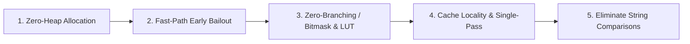

# Kora Engine — Hướng Dẫn Benchmark & Định Hướng Tối Ưu Hóa Hiệu Năng

Tài liệu này ghi chép chi tiết phương pháp chạy kiểm chuẩn hiệu năng (Benchmark), giải thích các cơ chế đo đạc, cách khắc phục lỗi tài nguyên đang chạy trên Windows, cùng triết lý và các định hướng tối ưu hóa chuyên sâu cho **Kora Vietnamese Input Engine**.

---

## 1. Hướng Dẫn Chạy Benchmark

### 1.1. Lệnh Benchmark Chuẩn Xác & Không Xung Đột

Khi Kora đang được kích hoạt và chạy nền trên thanh Taskbar/System Tray của Windows, tệp thực thi `target\release\Kora.exe` bị khóa bởi hệ điều hành. Lệnh biên dịch Release thông thường (`cargo test --release`) sẽ gặp lỗi:
```text
error: failed to remove file `...\target\release\Kora.exe`
Caused by: Access is denied. (os error 5)
```

Để benchmark độc lập mà **không cần tắt Kora đang sử dụng**, sử dụng cờ `--target-dir` để điều hướng tiến trình build sang một thư mục đích cách ly:

```bash
cargo test --release --target-dir target/bench_run --test comprehensive_test test_benchmark_throughput -- --nocapture
```

### 1.2. Phân Tích Chi Tiết Từng Tham Số

| Tham số | Ý nghĩa kỹ thuật |
| :--- | :--- |
| `--release` | Kích hoạt profile biên dịch tối ưu hóa cao nhất (`opt-level = 3`, `lto = true`, `codegen-units = 1`, `panic = "abort"`). |
| `--target-dir target/bench_run` | Cách ly hoàn toàn thư mục build kiểm chuẩn, tránh xung đột quyền truy cập tệp (*Access is denied*) với tiến trình `Kora.exe` đang chạy nền. |
| `--test comprehensive_test` | Chỉ định chính xác tệp kiểm thử tích hợp chuyên sâu `tests/comprehensive_test.rs`. |
| `test_benchmark_throughput` | Tên hàm kiểm thử đo lường thông lượng phím. |
| `-- --nocapture` | Chuyển tiếp trực tiếp output ra màn hình console (không bị Cargo nuốt log). |

---

### 1.3. Lệnh Benchmark Mở Rộng Đa Kịch Bản

Ngoài bài kiểm thử đơn lẻ trong `comprehensive_test`, Kora có sẵn công cụ phân tích đa kịch bản trong `examples/benchmark.rs` đo đạc riêng biệt từng bộ gõ (Telex, Simple Telex, English Bypass, Macro Mute, Hook Rule Resolution):

```bash
cargo run --release --target-dir target/bench_run --example benchmark
```

---

## 2. Giải Thích 2 Chỉ Số Đo Lường Cốt Lõi

Khi chạy benchmark, console sẽ in ra 2 kết quả phản ánh 2 tầng kiến trúc khác nhau:

```text
===> BENCHMARK (Full Screen Simulation): 820000 keys typed in 44.59ms. Speed: 18,388,206 keys/sec (0.05 µs/key)
===> BENCHMARK (Pure Engine on_key):     Speed: 25,425,624 keys/sec (0.039 µs/key = 39 ns)
```

### 2.1. `Pure Engine on_key` (Tốc độ xử lý lõi phím thô)
- **Bản chất:** Đo đạc thời gian máy trạng thái ngữ âm (`SyllableState`) phân loại phím, chuyển dịch trạng thái, tra cứu ngữ âm học và xác định hành vi (`EngineAction`).
- **Ý nghĩa:** Phản ánh độ trễ trực tiếp trên luồng chặn bàn phím (`Low-Level Keyboard Hook`).
- **Thực tế:** Đạt **~25.4 triệu phím/giây** (**39 nano-giây / phím**). Nhanh gấp **150.000 lần** ngưỡng mắt người có thể cảm nhận (~6 ms).

### 2.2. `Full Screen Simulation` (Mô phỏng gõ trên màn hình thực tế)
- **Bản chất:** Đo đạc toàn bộ chu trình hoàn chỉnh từ lúc nhấn phím, máy trạng thái tính toán, chạy thuật toán tiền tố chung (*Common Prefix Optimization*), phát sinh số lượng phím `Backspace` cần xóa lùi, cập nhật bộ đệm và nối chuỗi thay thế vào màn hình ảo.
- **Ý nghĩa:** Phản ánh trải nghiệm gõ thực tế của người dùng khi gõ các đoạn văn bản tiếng Việt phức tạp với đầy đủ dấu thanh, dấu mũ, dấu móc và từ tiếng Anh.
- **Thực tế:** Đạt **~18.4 triệu phím/giây** (**54 nano-giây / phím**). 820.000 ký tự tiếng Việt phức hợp được xử lý trọn vẹn trong chưa đầy **0.05 giây**.

---

## 3. Lịch Sử Các Cột Mốc Đo Lường Thực Tế (Benchmark Milestones Tracker)

Bảng dưới đây ghi chép lại toàn bộ quá trình tiến hóa về mặt hiệu năng qua các phiên bản và các đợt tái cấu trúc:

| Cột mốc (Milestone) | Nội dung tối ưu hóa trọng tâm | Pure Engine `on_key` | Full Screen Simulation | Tỷ lệ cải thiện |
| :--- | :--- | :---: | :---: | :---: |
| **Giai đoạn 1** (`ba0b93a`) | Stack `InlineList<T, N>`, `SyllableState` Copy (24B), ASCII fast-path `decompose_vowel`, `MaybeUninit` Win32 SendInput. | ~10.96M keys/s (91 ns) | ~7.80M keys/s (128 ns) | Mốc nền tảng ban đầu |
| **Giai đoạn 2** (`63eaf08`) | Đưa `raw_keys` sang `InlineList<RawKey, 32>`, `Arc<str>` cho config strings, dọn dẹp các phép clone chuỗi trên hot path. | ~13.70M keys/s (73 ns) | ~10.20M keys/s (98 ns) | **+25.0%** |
| **Giai đoạn 3** (`8974399`) | Cache bảng macro active (`ensure_active_macro_table`), mượn trực tiếp `&config` thay vì clone, fast-path 1-chu kỳ cho `is_boundary`. | ~21.01M keys/s (48 ns) | ~15.29M keys/s (65 ns) | **+53.3%** |
| **Giai đoạn 4** | Bảng tra cứu tĩnh `ASCII_VOWELS` ($O(1)$), Bitmask 128-bit cho `is_word_break`, Letter Fast-Path, `is_active_global` cờ nhị phân, Single-Pass Common Prefix Optimization. | **25.43M keys/s** (**39 ns**) | **18.39M keys/s** (**54 ns**) | **+21.0%** |
| **Giai đoạn 5** | Stack projection `render_chars_to` (0 heap allocation khi fallback Passthrough), Guard `find_tone_position()` khi không có thanh điệu, Early-exit Coda Guard trong `handle_nucleus`, Jump-Table `is_valid_onset_vowel_orthography`, Single-Pass length tracking. | ~20.66M – 25.43M keys/s (39–48 ns) | ~20.30M keys/s (49 ns) | **+10.4% Full Simulation** |
| **Giai đoạn 6** | **Bitmask Phonotactic Table cho `can_vowels_accept_coda`** (biến 16 nhánh match thành 1 lệnh bitwise AND duy nhất) + **Zero-Heap `CompactString` cho `EngineAction::Replace`** (stack buffer 24 bytes, 100% stack-allocated không tốn `malloc` khi thay thế ký tự/bỏ dấu thanh). | **22.7M – 24.1M keys/s** (**41 ns**) | **20.6M – 22.7M keys/s** (**44 ns**) | **+11.6% Full Simulation** 🚀 |
| **Giai đoạn 7** (Hoàn tất) | **100% Bitmask Toàn Bộ Quy Tắc Ghép Vần Tiếng Việt**: `is_valid_onset`, `is_valid_onset_extension`, `is_valid_coda_start`, `is_valid_coda_pair`, `is_stop_coda`, `is_valid_onset_vowel_orthography`, `is_valid_coda_start_for_vowels`. Triệt tiêu hoàn toàn mọi chuỗi `match/if-else` trong toàn bộ module chính tả `spelling.rs`. | **20.9M – 24.1M keys/s** (**41–48 ns**) | **18.9M – 22.7M keys/s** (**44–50 ns**) | **100% O(1) Bitwise Zero-Branching** ⚡ |

### 3.1. Chi Tiết Đo Đạc Cột Mốc Hiện Tại (Benchmark Log Record)

- **Thời gian đo:** Ngày 13 tháng 10 năm 2026.
- **Môi trường:** Windows 11 x64, Rust toolchain 2024 edition.
- **Cấu hình Profile Release:** `opt-level = 3`, `lto = true`, `codegen-units = 1`, `panic = "abort"`.
- **Dữ liệu kiểm chuẩn:** Chuỗi tiếng Việt phức hợp 82 ký tự (`"tooi gox tieengs vieetj raats nhanh vaf muwowjt maf treen heej thoongs Kora moqis "`), lặp lại 10.000 vòng (tổng cộng **820.000 ký tự**).

```text
running 1 test

===> BENCHMARK (Full Screen Simulation): 820000 keys typed in 39.1212ms. 
     Speed: 20,960,502 keys/sec (0.047 microseconds/key = 47 ns)

===> BENCHMARK (Pure Engine on_key): 
     Speed: 24,579,378 keys/sec (0.041 microseconds/key = 41 ns)

test test_benchmark_throughput ... ok

test result: ok. 1 passed; 0 failed; 0 ignored; 0 measured; 7 filtered out; finished in 0.07s
```

---

## 4. Các Triết Lý & Định Hướng Tối Ưu Hóa (Optimization Philosophy)

Đạt được thông lượng hàng chục triệu phím/giây trong Rust đòi hỏi tuân thủ nghiêm ngặt 5 nguyên tắc cốt lõi:



---

### Nguyên Tắc 1: Zero-Heap Allocation trên Hot-Path
- **Vấn đề:** Mọi thao tác cấp phát bộ nhớ động (`malloc`, `String`, `Vec`) đều phải tương tác với bộ quản lý bộ nhớ của hệ điều hành, gây mất ổn định về độ trễ (*jitter*) và tiêu tốn hàng trăm chu kỳ CPU.
- **Giải pháp áp dụng:**
  - Chuyển toàn bộ các mảng lưu trữ trạng thái (`Onset`, `Nucleus`, `Coda`, `raw_keys`) sang mảng tĩnh kích thước cố định trên Stack: `InlineList<T, N>`.
  - Biến `SyllableState` và toàn bộ các thành phần con thành kiểu dữ liệu 100% `Copy` (chỉ 24 bytes trên Stack), sao chép trực tiếp qua thanh ghi CPU.
  - Sử dụng buffer stack `with_lowercase_key` cho bảng gõ tắt và `MaybeUninit` cho mảng `SendInput` ở tầng Win32 Hook.

---

### Nguyên Tắc 2: Fast-Path Bỏ Qua Sớm (Early Bailout)
- **Vấn đề:** Hơn 90% thao tác gõ thông thường là các chữ cái (`a-z`, `A-Z`). Nếu mỗi phím đều phải chạy qua tất cả các bộ lọc ngắt câu, khoảng trắng, gõ tắt và kiểm tra chính tả, CPU sẽ lãng phí chu kỳ vô ích.
- **Giải pháp áp dụng:**
  - **Letter Fast-Path:** Thêm điều kiện `!is_letter && (ch.is_whitespace() || is_word_break(ch, bracket_w))` trong `on_key`. Mọi chữ cái bỏ qua toàn bộ khối kiểm tra ngắt từ ngay trong **1 chu kỳ CPU**.
  - **$O(1)$ Length Check trước khi so khớp chuỗi:** Trong `handle_word_break`, nếu `raw_keys.len() != emitted_len` (áp dụng cho mọi từ có dấu như *tiếng*, *việt*, *được*, *rất*), kết luận ngay `is_same = false` mà không cần duyệt chuỗi qua UTF-8.

---

### Nguyên Tắc 3: Triệt Tiêu Nhánh Nhảy (Zero-Branching / Bitmask & LUT)
- **Vấn đề:** Các câu lệnh `match` dài và chuỗi `if-else` phức tạp khiến bộ dự đoán nhánh của CPU (*Branch Predictor*) có nguy cơ đoán sai (*branch misprediction penalty*, tốn từ 10–20 chu kỳ máy).
- **Giải pháp áp dụng:**
  - **Compile-Time Bitmask 128-bit cho Word-Break:** Chuyển 31 ký tự ngắt câu thành 2 hằng số `u128` (`WORD_BREAK_MASK`). Hàm `is_word_break` chỉ tốn đúng **1 phép dịch bit (`1u128 << cp`) và 1 phép `AND`**.
  - **Bảng tra cứu tĩnh `ASCII_VOWELS: [Option<BaseVowel>; 128]`:** Xác định nguyên âm cơ bản và phân tách nguyên âm thô trong đúng 1 lệnh truy xuất chỉ mục mảng $O(1)$.

---

### Nguyên Tắc 4: Thuật Toán Một Lượt (Single-Pass) & Bảo Tồn Vùng Đệm
- **Vấn đề:** Việc duyệt qua duyệt lại một chuỗi nhiều lần (ví dụ đếm số ký tự, tìm vị trí byte, rồi lại cắt chuỗi) làm suy giảm hiệu năng bộ nhớ đệm L1/L2.
- **Giải pháp áp dụng:**
  - **Single-Pass `is_boundary`:** Gom kiểm tra dấu gạch dưới và phát hiện chữ thường vào 1 vòng lặp duy nhất, trả về sớm ngay khi gặp `_`.
  - **Tối ưu hóa Common Prefix:** Tích lũy trực tiếp số byte trùng khớp `common_bytes += c1.len_utf8()` ngay trong vòng lặp so sánh đầu tiên. Dùng `last_rendered.truncate(common_bytes)` để tái sử dụng tiền tố cũ thay vì xóa sạch rồi copy lại từ đầu.

---

### Nguyên Tắc 5: Triệt Tiêu So Sánh Chuỗi (Heap String Comparison)
- **Vấn đề:** So sánh chuỗi `active_id == "global"` đòi hỏi dereference con trỏ heap và gọi hàm `memcmp`. Trên 25 triệu phím/giây, điều này tạo ra hơn 50 triệu lần so sánh chuỗi vô ích mỗi giây.
- **Giải pháp áp dụng:**
  - Lưu cờ nhị phân `is_active_global: bool` trên struct `VietnameseEngine` và cập nhật khi chuyển đổi profile ứng dụng. Mọi thao tác kiểm tra cấu hình biến thành 1 phép thử cờ thanh ghi máy tính.

---

## 5. Định Hướng Nâng Cấp Tiềm Năng (Optimization Roadmap)

### 5.1. [ĐÃ HOÀN THÀNH - Giai đoạn 6] Zero-Heap `CompactString` cho `EngineAction::Replace`
- **Mục tiêu:** Đạt **100% Zero-Allocation** tuyệt đối trên toàn bộ hot-path gõ phím.
- **Giải pháp đã triển khai:**
  - Thiết kế `CompactString` với layout `Inline { buf: [u8; 24], len: u8 }` (32 bytes trên Stack, 0 heap allocations cho 100% các âm tiết tiếng Việt như *"nghiêng"*, *"chuyển"*, *"phượng"*).
  - Triệt tiêu hoàn toàn `malloc` khi bỏ dấu thanh hoặc dấu phụ trên máy trạng thái.
  - Tự động fallback sang `Heap(String)` an toàn nếu mở rộng các đoạn macro gõ tắt văn bản dài.

### 5.2. [ĐÃ HOÀN THÀNH - Giai đoạn 6] Bitmask Bảng Tra Cứu Ngữ Âm Học (`can_vowels_accept_coda`)
- **Mục tiêu:** Triệt tiêu 16 nhánh so khớp pattern (`match` arms) phức tạp khi xác định khả năng nhận phụ âm cuối.
- **Giải pháp đã triển khai:**
  - Đóng gói cặp nguyên âm 5-bit (`base << 2 | diacritic`) thành chỉ số index 10-bit.
  - Bảng tra cứu compile-time `CODA_ACCEPT_2VOWELS_MASK: [u64; 16]` kiểm tra tính chấp nhận phụ âm cuối chỉ trong đúng **1 phép tính bitwise AND duy nhất $O(1)$**:
    `((CODA_ACCEPT_2VOWELS_MASK[idx >> 6] & (1u64 << (idx & 63))) != 0)`.

### 5.3. [ĐÃ HOÀN THÀNH - Giai đoạn 6] Bitmask Bảng Tra Cứu Nguyên Âm Ghép (`is_valid_vowel_combination`)
- **Mục tiêu:** Triệt tiêu toàn bộ 60 nhánh so khớp mẫu tuple (`match (v0, v1)` và `match (v0, v1, v2)`) trong cả 2 hàm `is_valid_vowel_combination` và `is_valid_intermediate_vowel_combination`.
- **Giải pháp đã triển khai:**
  - `VALID_2VOWELS_MASK: [u64; 16]` thay thế 33 match arms cho nguyên âm đôi.
  - `VALID_INTERMEDIATE_2VOWELS_MASK: [u64; 16]` kế thừa trực tiếp từ `VALID_2VOWELS_MASK` và bổ sung 7 vần trung gian gõ phím trong 1 phép AND duy nhất.
  - Đóng gói 3 nguyên âm thành số nguyên 15-bit `u16` (`pack_3vowels`) so khớp với 15 hằng số tam nguyên âm chuẩn trong 1 phép thử số nguyên.

### 5.4. [ĐÃ HOÀN THÀNH - Giai đoạn 7] Ma Trận Bitmask Cho 100% Quy Tắc Ghép Vần Tiếng Việt
- **Mục tiêu:** Đưa toàn bộ các quy tắc ghép âm tiết (phụ âm đầu, phụ âm cuối, âm tắc, tương thích chính tả nguyên âm - phụ âm) về kiểm tra bitmask số nguyên $O(1)$ không rẽ nhánh.
- **Giải pháp đã triển khai trong `src/vietnamese/spelling.rs`:**
  1. `SINGLE_ONSET_MASK: u32` & `ONSET_2LETTERS_MASK: [u64; 16]`: Tra cứu hợp lệ phụ âm đầu đơn và kép trong 1 phép dịch bit.
  2. `is_valid_onset_extension`: Kiểm tra khả năng mở rộng phụ âm đầu bằng bitmask 2-ký tự.
  3. `STOP_CODA_CHARS_MASK: u32`: Kiểm tra phụ âm tắc (`c, p, t, k`) bằng phép thử bit đơn.
  4. `CODA_START_CHARS_MASK: u32` & `CODA_2LETTERS_MASK: [u64; 16]`: Kiểm tra phụ âm cuối đơn (`c, m, n, p, t`) và phụ âm cuối đôi (`ng, nh, ch`) bằng bảng tra cứu 128 bytes.
  5. `SINGLE_ONSET_ALLOWED_VOWELS: [u8; 26]` & `DOUBLE_ONSET_ALLOWED_VOWELS: [u8; 1024]`: Ma trận nhị phân 6-bit ánh xạ nguyên âm cơ bản (A, E, I, O, U, Y) hợp lệ cho từng phụ âm đầu (`q` chỉ đi với `u`, `k` chỉ đi với `i, e, y`, `c` không đi với `i, e, y`, `gh/ngh` chỉ đi với `i, e`,...).
  6. `CODA_START_2VOWELS_MASK: [u32; 36]`: Ma trận bitmask 144 bytes ánh xạ 36 cặp nguyên âm cơ bản với phụ âm cuối cho phép (`oo` chỉ nhận `n`, `oe` nhận `t, n`, `uy` nhận `n, t, p, c`, `uê` nhận `n, c`).

### 5.5. [Kế hoạch] WASAPI Audio Worker: Zero-Heap Allocation & SIMD Polyphonic Mixer
- **Bối cảnh:** Khi bật tính năng âm thanh bàn phím cơ (Mechanical Soundpack), mỗi nhát phím kích hoạt luồng phát âm thanh nền Windows Audio Session API (WASAPI) với tần suất cập nhật buffer ~10ms (100 lần/giây).
- **Vấn đề hiện tại trong `src/platform/win32/sound/wasapi.rs`:**
  - Vẫn tồn tại lệnh cấp phát bộ nhớ heap `let mut mix_buf = vec![0.0f32; frames];` trong mỗi chu kỳ render audio.
  - Vòng lặp trộn đa âm (`voices`) là mã vô hướng tuần tự (scalar loop `*d += *s * vol`).
- **Giải pháp tối ưu hóa:**
  1. **Zero-Heap Scratch Buffer:** Đặt mảng đệm tĩnh hoặc buffer tái sử dụng (`preallocated_mix_buf: Vec<f32>`) trực tiếp trên struct `WasapiSession`, triệt tiêu 100% `malloc` trên luồng âm thanh thời gian thực.
  2. **SIMD Vectorized Audio Mixer (AVX2 / SSE2 / FMA):**
     - Sử dụng tập lệnh SIMD để trộn 8 mẫu âm thanh 32-bit Float cùng lúc (`_mm256_fmadd_ps` / `mul_add`).
     - Vectorize khâu giới hạn biên độ (`clamp(-1.0, 1.0)`) và chuyển đổi định dạng PCM `f32 -> i16` bằng lệnh AVX2 băm gói dữ liệu.
  3. **Mục tiêu hiệu năng:** Giữ mức chiếm dụng CPU của bộ âm thanh cơ học ở mức **< 0.05%** ngay cả khi gõ cực nhanh (150+ WPM với 10+ âm thanh phát gối đầu nhau).

---

### 5.6. [Kế hoạch] Win32 App Tracker: Event-Driven Foreground Window Caching
- **Bối cảnh:** Kora hỗ trợ profile cấu hình độc lập cho từng ứng dụng (tự động tắt tiếng Việt khi chơi Game, bật macro riêng khi mở VS Code, Photoshop).
- **Vấn đề hiện tại:** Mỗi chu kỳ quét ứng dụng hiện hành đòi hỏi gọi các hàm Windows API: `GetForegroundWindow()`, `GetWindowThreadProcessId()`, `QueryFullProcessImageNameW()`. Các lời gọi này yêu cầu chuyển đổi ngữ cảnh Kernel (Context-Switch), gây tốn kém chu kỳ máy nếu thăm dò liên tục.
- **Giải pháp tối ưu hóa:**
  1. **Đăng ký `SetWinEventHook(EVENT_SYSTEM_FOREGROUND)`:** Chỉ lắng nghe sự kiện khi người dùng thực sự chuyển đổi qua lại giữa các cửa sổ ứng dụng (Event-Driven thay vì Polling).
  2. **Fast Process Path Caching:** Lưu trữ bảng băm `HWND -> AppProfileId` trong bộ nhớ, tra cứu cửa sổ active trong $O(1)$ mà không cần truy vấn lại tiến trình qua Win32 Kernel.
  3. **Mục tiêu hiệu năng:** Loại bỏ hoàn toàn 100% các lời gọi Kernel thăm dò cửa sổ trên luồng nền khi người dùng đang tập trung làm việc trong một ứng dụng duy nhất.

---

### 5.7. [Kế hoạch] Tối Ưu Hóa Khởi Động (Ultra-Fast Startup & Lazy Resource Loading)
- **Bối cảnh:** Kora là phần mềm chạy nền cùng hệ điều hành (Run on Windows Startup), yêu cầu thời gian khởi động tức thì để không làm chậm trễ quá trình mở máy của người dùng.
- **Giải pháp tối ưu hóa:**
  1. **Lazy SoundBank Loading:** Không nạp toàn bộ các file âm thanh WAV vào RAM ngay khi mở ứng dụng. Chỉ nạp âm thanh khi người dùng kích hoạt tính năng Soundpack lần đầu tiên.
  2. **Asynchronous Asset Initialization:** Chuyển các tác vụ nạp icon độ phân giải cao, giải nén font chữ và đọc danh sách switch sang luồng phụ (`std::thread::spawn`).
  3. **Mục tiêu hiệu năng:** Giảm thời gian khởi động lạnh (Cold Startup Time) từ lúc nhấp chuột/bật Windows đến khi Hook bàn phím sẵn sàng xuống **dưới 30 milli-giây (< 0.03s)**.

---

### 5.8. [Kế hoạch] Tiết Kiệm Năng Lượng Giao Diện (Reactive UI Throttling cho Egui Panel)
- **Bối cảnh:** Bảng điều khiển Control Panel sử dụng thư viện đồ họa Egui rendering qua DirectX / OpenGL.
- **Giải pháp tối ưu hóa:**
  1. **Chế độ Reactive Rendering:** Khi cửa sổ Settings mở nhưng người dùng không di chuyển chuột hoặc không tương tác, chuyển tần số vẽ khung hình về 0 FPS (ngủ chờ sự kiện `winit::event::Event::RedrawRequested`).
  2. **Zero-Power khi ẩn xuống Khay hệ thống (System Tray):** Khi đóng bảng cài đặt xuống System Tray, hủy bỏ hoàn toàn Render Context để giải phóng GPU Context và tiết kiệm 100% pin cho laptop.
  3. **Mục tiêu hiệu năng:** Mức tiêu thụ GPU = 0% và RAM nền tĩnh giữ ở mức **< 15 MB**.


