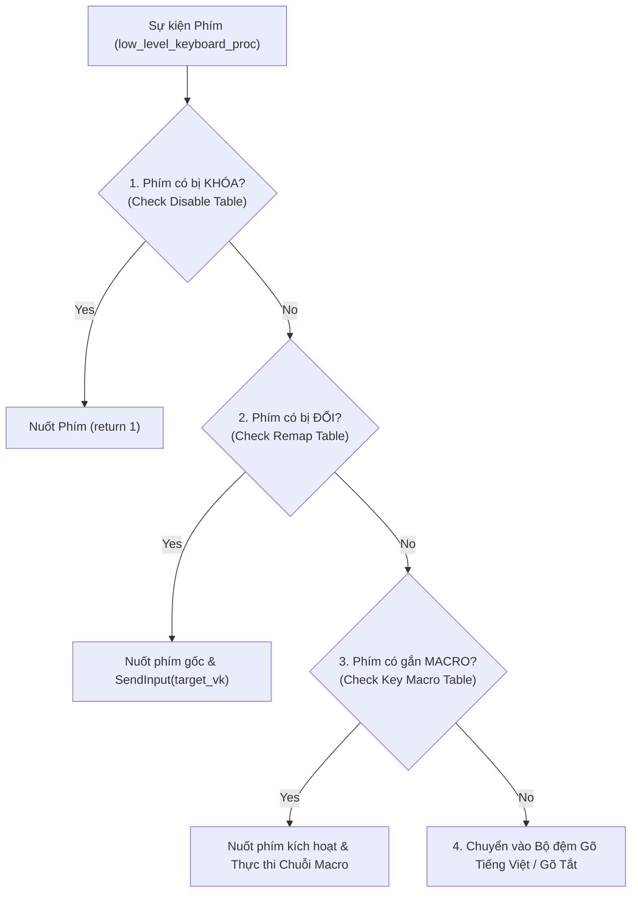

# TÀI LIỆU THIẾT KẾ KIẾN TRÚC HỆ THỐNG KORA KEYBOARD HUB
## Phân Hệ: Multi-Profile Workspace, Key Remapping, Key Disabling & Key Macro Engine

---

## 1. TỔNG QUAN & TRIẾT LÝ THIẾT KẾ (DESIGN PHILOSOPHY)

### 1.1. Bối cảnh & Tầm nhìn
**Kora** xuất phát điểm là một bộ gõ tiếng Việt siêu nhẹ, hiệu năng cao viết bằng Pure Rust và Native Win32 GDI API. Nhằm nâng tầm Kora từ một "bộ gõ tiếng Việt" thông thường trở thành một **Keyboard Workspace Hub** toàn diện (sánh ngang Razer Synapse, Logitech G HUB, Corsair iCUE hay Microsoft PowerToys nhưng giữ vững bản sắc siêu nhẹ dưới 1 MB RAM, zero-dependency, zero-GC input lag), phân hệ **Quản lý Bàn phím & Multi-Profile** được thiết kế như một kiến trúc trung tâm (First-class Citizen).

### 1.2. Triết lý "Profile-First Hub"
* **Mọi cấu hình gắn liền với một Profile:** Toàn bộ trạng thái gõ (Tiếng Việt / Tiếng Anh), kiểu gõ (Telex / VNI), phím chuyển $E \leftrightarrow V$, âm thanh gõ phím cơ WASAPI, bộ từ điển gõ tắt văn bản, cùng bộ ba quyền năng của bàn phím:
  1. 🔄 **Đổi phím (Key Remapping):** Đổi 1 phím vật lý sang 1 phím khác.
  2. 🚫 **Khóa phím (Key Disabling):** Chặn hoàn toàn phím bấm nhầm khi chơi game hoặc làm việc.
  3. ⚡ **Phím Macro (Key Macro):** Ấn 1 phím kích hoạt gửi một chuỗi phím, tổ hợp phím hoặc kịch bản phím tự động.
* **Tự động nhận diện ứng dụng (Active App Tracking):** Khi người dùng chuyển cửa sổ làm việc (Alt+Tab hoặc click chuột), Kora tự động nhận diện tiến trình foreground và kích hoạt Profile tương ứng với độ trễ micro-giây.

### 1.3. Phân biệt Dứt khoát giữa "Gõ tắt" và "Macro phím"
Nhằm triệt tiêu sự mơ hồ trong trải nghiệm người dùng cũng như kiến trúc mã nguồn:
* **Gõ tắt (Text Expansion / Shorthand):** Thuộc phân hệ Soạn thảo & Bộ gõ tiếng Việt. Người dùng gõ một từ viết tắt kèm phím kích hoạt (Space/Enter) để bung ra một đoạn văn bản (`vn` + `Space` $\to$ `Việt Nam`).
* **Phím Macro (Key Macro / Keystroke Sequence):** Thuộc phân hệ Quản lý Bàn phím. Người dùng ấn một phím cứng vật lý (ví dụ: `F1`, `Caps Lock`, `Scroll Lock`...) để hệ thống tự động phát ra một chuỗi hành động thời gian thực (`down`, `up`, `press`, `delay`).

---

## 2. BỘ BA TRỤ CỘT QUẢN LÝ BÀN PHÍM (THE KEYBOARD TRIFECTA)

Phân hệ Quản lý Bàn phím được quy chuẩn thành bộ ba tính năng đối xứng hoàn hảo cả về ngôn ngữ hiển thị lẫn kiến trúc xử lý:

```
┌─────────────────────────────────────────────────────────────────────────────┐
│                       QUẢN LÝ BÀN PHÍM (KEYBOARD ENGINE)                     │
├───────────────────────┬─────────────────────────┬───────────────────────────┤
│ 🔄 ĐỔI PHÍM (Remap)   │ 🚫 KHÓA PHÍM (Disable)   │ ⚡ MACRO (Key Macro)       │
├───────────────────────┼─────────────────────────┼───────────────────────────┤
│ 1 Phím ➜ 1 Phím khác  │ 1 Phím ➜ Chặn tín hiệu  │ 1 Phím ➜ Chuỗi hành động  │
│                       │                         │                           │
│ Ví dụ:                │ Ví dụ:                  │ Ví dụ:                    │
│ Caps Lock ➜ Ctrl      │ Khóa Left Windows       │ down(W) + delay(200) +    │
│ Insert ➜ Delete       │ Khóa Caps Lock khi chơi │ press(Space) + delay(50) +│
│ F1 ➜ Escape           │ game, khóa Insert       │ up(W) + press(X)          │
└───────────────────────┴─────────────────────────┴───────────────────────────┘
```

---

## 3. MÔ HÌNH HÀNH ĐỘNG TỔNG QUÁT CỦA PHÍM MACRO (UNIFIED ACTION PIPELINE)

Mọi macro trong Kora được chuẩn hóa thành **một chuỗi tuyến tính duy nhất** gồm các hàm hành động nối với nhau bằng dấu `+`:

$$\text{Trigger Key} = \text{action}_1 + \text{action}_2 + \text{action}_3 + \dots$$

### 3.1. Bốn Viên Gạch Cơ Sở & Hàm Tiện Ích

| Hàm | Ý nghĩa | Cách thức hoạt động | Ví dụ |
| :--- | :--- | :--- | :--- |
| **`press(...)`** | Gõ nhanh | Thực hiện nhanh 1 lần `down` rồi `up` ngay lập tức | `press(Space)`, `press(X)`, `press(Ctrl+Shift+L)` |
| **`down(...)`** | Nhấn giữ | Gửi tín hiệu đè phím xuống (KeyDown) | `down(W)`, `down(Shift)`, `down(Ctrl)` |
| **`up(...)`** | Nhả phím | Gửi tín hiệu thả phím ra (KeyUp) | `up(W)`, `up(Shift)`, `up(Ctrl)` |
| **`delay(...)`** | Chờ thời gian | Dừng lại một khoảng mili-giây trước khi thực hiện bước tiếp | `delay(200)`, `delay(50)` |
| **`text(...)`** | Gõ chuỗi ký tự | Tiện ích gom nhiều lần `press` ký tự liên tiếp | `text(admin)` $\equiv$ `press(a)+press(d)+press(m)+press(i)+press(n)` |

### 3.2. Mối Quan Hệ Bản Chất Giữa Các Hàm (Kim Tự Tháp 3 Tầng)

Bản chất ở tầng phần cứng bàn phím và Windows Driver chỉ có 2 tín hiệu duy nhất là **`down`** và **`up`**. Các hàm cấp cao hơn thực chất là sự đóng gói tiện lợi của tầng dưới:

```
[Tầng 3: Văn bản]       text("kien")
                             │
                             ▼ (gọi liên tiếp nhiều press)
[Tầng 2: Gõ nhanh]      press(k)    ➔    press(i)    ➔    press(e)    ➔    press(n)
                             │
                             ▼ (mỗi press gọi tuần tự down rồi up)
[Tầng 1: Nguyên tử]     down(k) ➔ up(k)   down(i) ➔ up(i)   down(e) ➔ up(e)   down(n) ➔ up(n)
```

1. **Phím đơn:**
   $$\mathbf{press}(X) \quad \Longrightarrow \quad \mathbf{down}(X) \;\longrightarrow\; \mathbf{up}(X)$$
2. **Tổ hợp phím — `press(Ctrl+Shift+L)`:**
   Hệ thống tự động bóc tách các phím bổ trợ (`Ctrl`, `Shift`) và phím chính (`L`), sinh ra chuỗi LIFO nguyên tử gửi qua Win32 `SendInput`:
   $$\begin{aligned}
   \mathbf{press}(\text{Ctrl+Shift+L}) \quad \Longrightarrow \quad & \mathbf{down}(\text{Ctrl}) \\
   \longrightarrow \quad & \mathbf{down}(\text{Shift}) \\
   \longrightarrow \quad & \mathbf{down}(L) \\
   \longrightarrow \quad & \mathbf{up}(L) \\
   \longrightarrow \quad & \mathbf{up}(\text{Shift}) \\
   \longrightarrow \quad & \mathbf{up}(\text{Ctrl})
   \end{aligned}$$
   *(Toàn bộ chuỗi 6 sự kiện này được phát trong 1 lệnh gọi `SendInput` duy nhất, triệt tiêu 100% rủi ro kẹt phím).*
3. **So sánh linh hoạt giữa viết nhanh và viết thủ công:**
   * **Cách viết nhanh (Khuyên dùng):** `press(Ctrl+Shift+L)` hoặc `press(Ctrl+C)`
   * **Cách viết thủ công (Khi muốn chèn delay ở giữa):** `down(Ctrl) + delay(300) + press(C) + up(Ctrl)`

### 3.3. Khả Năng Biểu Diễn Mọi Kịch Bản

Nhờ mô hình tổng quát này, người dùng có thể xây dựng mọi kịch bản từ đơn giản đến phức tạp:

1. **Combo Game hành động / FPS / MOBA:**
   ```ini
   F1 = down(W) + delay(200) + press(Space) + delay(50) + up(W) + press(X)
   ```
2. **Giữ phím bổ trợ để gõ liên hoàn:**
   ```ini
   F2 = down(Shift) + press(K) + press(I) + press(E) + press(N) + up(Shift)
   ```
3. **Phím tắt phần mềm & IDE:**
   ```ini
   F3 = press(Ctrl+Shift+L)
   F4 = press(Ctrl+Shift+P) + delay(100) + text(Format Document) + press(Enter)
   ```
4. **Điền biểu mẫu tự động:**
   ```ini
   F5 = text(admin@kora.io) + press(Tab) + text(SecretPass123) + press(Enter)
   ```
5. **Xóa toàn bộ văn bản và thay thế:**
   ```ini
   F6 = press(Ctrl+A) + press(Delete) + text(Đã cập nhật thành công!) + press(Enter)
   ```

---

## 4. MÔ HÌNH KẾ THỪA VÀ PHÂN LOẠI THIẾT LẬP (INHERITANCE & DELTA MODEL)

Toàn bộ thiết lập trong Kora được chia thành **3 nhóm hành vi dứt khoát**:

```
[🌐 Profile Toàn Hệ Thống (Root / Global)]
  ├── Nguồn chân lý duy nhất (Single Source of Truth)
  └── Luôn chạy nền mặc định cho mọi ứng dụng chưa có profile riêng
         │
         ├── (1) Nhóm Select: Tự động kế thừa thời gian thực (hoặc chọn ghi đè riêng)
         ├── (2) Nhóm Checkbox 3 trạng thái: Kế thừa (None) hoặc Ghi đè riêng (Some)
         └── (3) Nhóm Bảng dữ liệu: Kế thừa động Delta (Live Delta Overlay)
         │
         ▼
[🎯 Profile Ứng Dụng Con (CS2, VS Code, Word, Photoshop...)]
```

### 4.1. Phân loại 3 Nhóm Thiết Lập

#### 📌 Nhóm 1: Thiết lập dạng Lựa chọn (Select / ComboBox / Hotkey Picker)
* **Cơ chế:** Kế thừa động có thể tùy biến (*Dynamic Inherit or Specific Override*).
* **Bao gồm:**
  - **Chế độ gõ (`LanguageMode`):** `Inherit` (Kế thừa từ Root) | `Vietnamese` | `English`.
  - **Kiểu gõ (`MethodMode`):** `Inherit` (Kế thừa từ Root) | `Telex` | `VNI` | `SimpleTelex`.
  - **Phím chuyển đổi E ⇄ V (`switch_key`):** `None` (Kế thừa phím của Root) | `Some(Hotkey)` (Phím riêng).

#### 📌 Nhóm 2: Checkbox 3 Trạng thái kèm Nhãn Ngữ cảnh (Tri-State Contextual Checkbox)
* **Cơ chế:** Kế thừa 3 trạng thái có chú thích minh bạch (*Tri-State with Dynamic Contextual Label*).
* **Bao gồm:** `use_macro`, `use_macro_in_english_mode`, `restore_on_wrong_spelling`, `auto_uppercase_first_char`, `bracket_w`, `remember_history_across_space`, `sound_enabled`.
* **Bảng trạng thái trực quan:**

| Kiểu dữ liệu Rust | Trạng thái Glyph | Nhãn hiển thị trên UI | Hành vi hệ thống |
| :--- | :---: | :--- | :--- |
| **`None`** *(Kế thừa Global)* | `[-]` hoặc `[■]` | `Tùy chọn (Kế thừa Global: Bật / Tắt)` | Ăn theo Global theo thời gian thực. Global đổi là app đổi theo. |
| **`Some(true)`** *(Bật riêng)* | `[✓]` *(Checked)* | `Tùy chọn (Bật riêng)` | Ép bật cho riêng app này, bất chấp Global. |
| **`Some(false)`** *(Tắt riêng)* | `[ ]` *(Unchecked)* | `Tùy chọn (Tắt riêng)` | Ép tắt cho riêng app này, bất chấp Global. |

#### 📌 Nhóm 3: Bảng Dữ liệu Quy tắc Kế thừa Delta (Live Delta Overlay)
* **Cơ chế:** Kế thừa động theo mô hình Delta (*Live Delta Overlay*).
* **Áp dụng cho cả 4 danh mục dữ liệu bảng:**
  1. Bảng từ viết tắt (Gõ tắt văn bản).
  2. Bảng đổi phím (Key Remap).
  3. Bảng khóa phím (Key Disable).
  4. Bảng phím macro (Key Macro).
* **Công thức hợp nhất thời gian thực:**
  $$\text{ActiveRules}_{\text{App}} = (\text{GlobalRules} \setminus \text{MutedRules}_{\text{App}}) \cup \text{OverriddenRules}_{\text{App}} \cup \text{AppSpecificRules}$$
* **Hành vi:** Profile con **không copy dữ liệu thô** của Root mà đọc động qua bộ lọc Delta:
  - `[+]` Thêm quy tắc riêng: Lưu vào `app_*`, hiển thị nhãn `✨ Riêng app này`.
  - `[~]` Ghi đè quy tắc của Root: Lưu vào `overridden_*`, hiển thị nhãn `✏️ Ghi đè Global`.
  - `[-]` Tắt quy tắc của Root: Lưu vào `muted_*` (Tombstone), hiển thị nhãn `🚫 Đã tắt`.

---

## 5. THIẾT KẾ CẤU TRÚC DỮ LIỆU (DATA MODEL TRONG RUST)

```rust
use std::collections::HashMap;

/// Hành động nguyên tử trong chuỗi Macro
#[derive(Debug, Clone, PartialEq, Eq)]
pub enum MacroAction {
    /// Nhấn rồi nhả nhanh một phím hoặc tổ hợp phím (Down + Up)
    Press(String),
    /// Nhấn giữ một phím (KeyDown)
    Down(String),
    /// Nhả một phím (KeyUp)
    Up(String),
    /// Dừng chờ mili-giây
    Delay(u32),
    /// Gõ chuỗi ký tự (Gom nhiều lần Press)
    Text(String),
}

/// Quy tắc Phím Macro
#[derive(Debug, Clone, PartialEq, Eq)]
pub struct KeyMacroRule {
    pub trigger_vk: u16,             // Mã phím bấm kích hoạt (e.g. VK_F1, VK_CAPITAL)
    pub trigger_name: String,        // Tên hiển thị (e.g. "F1", "Caps Lock")
    pub name: String,                // Tên mô tả ngắn của macro (e.g. "Auto Login", "Combo CS2")
    pub raw_dsl: String,             // Chuỗi DSL nguyên bản: "down(W) + delay(200) + press(Space)..."
    pub actions: Vec<MacroAction>,   // Danh sách các hành động đã phân tích cú pháp
}

/// Quy tắc Đổi phím (Key Remap)
#[derive(Debug, Clone, PartialEq, Eq)]
pub struct KeyRemapRule {
    pub from_vk: u16,
    pub to_vk: u16,
    pub from_name: String,
    pub to_name: String,
}

/// Quy tắc Khóa phím (Key Disable)
#[derive(Debug, Clone, PartialEq, Eq)]
pub struct KeyDisableRule {
    pub vk: u16,
    pub name: String,
}

/// Cấu hình đầy đủ của một App Profile
#[derive(Debug, Clone)]
pub struct AppProfile {
    pub id: String,                         // "global", "cs2", "vscode"
    pub name: String,                       // "Toàn hệ thống", "Counter-Strike 2"
    pub process_names: Vec<String>,         // ["cs2.exe"]
    pub icon: String,                       // "🌐", "🎮", "💻"
    pub is_root: bool,

    // 1. Bộ gõ & Ngôn ngữ (Nhóm 1 Select & Nhóm 2 Checkbox)
    pub mode: LanguageMode,                 // Inherit | Vietnamese | English
    pub method: MethodMode,                 // Inherit | Telex | VNI | SimpleTelex
    pub switch_key: Option<String>,         // None = Kế thừa hotkey của Global
    pub smart_spell: Option<bool>,
    pub free_typing: Option<bool>,
    pub auto_uppercase: Option<bool>,
    pub bracket_w: Option<bool>,
    pub remember_history: Option<bool>,

    // 2. Âm thanh gõ phím cơ WASAPI
    pub sound_enabled: Option<bool>,
    pub sound_switch: Option<String>,
    pub sound_volume: Option<u8>,

    // 3. Gõ tắt văn bản (Text Expansion - Nhóm 3 Delta)
    pub use_macro: Option<bool>,
    pub macro_in_english: Option<bool>,
    pub muted_text_macros: Vec<String>,
    pub overridden_text_macros: HashMap<String, (String, crate::engine::macro_table::MacroType)>,
    pub app_text_macros: Vec<crate::engine::macro_table::MacroEntry>,

    // 4. Bảng Đổi phím (Key Remap - Nhóm 3 Delta)
    pub muted_remaps: Vec<u16>,             // from_vk của Global bị tắt riêng
    pub overridden_remaps: HashMap<u16, u16>,// from_vk -> to_vk ghi đè riêng
    pub app_remaps: Vec<KeyRemapRule>,      // Cặp đổi phím thêm riêng cho app

    // 5. Bảng Khóa phím (Key Disable - Nhóm 3 Delta)
    pub unmuted_disabled: Vec<u16>,         // Phím Global chặn nhưng app này cho phép bấm
    pub app_disabled: Vec<KeyDisableRule>,  // Phím bị chặn riêng trong app này

    // 6. Bảng Phím Macro (Key Macro - Nhóm 3 Delta)
    pub muted_key_macros: Vec<u16>,         // trigger_vk của Global bị tắt riêng trong app
    pub overridden_key_macros: HashMap<u16, KeyMacroRule>, // trigger_vk ghi đè nội dung riêng
    pub app_key_macros: Vec<KeyMacroRule>,  // Phím Macro thêm riêng cho app
}
```

---

## 6. ĐỊNH DẠNG LƯU TRỮ CẤU HÌNH (ZERO-DEPENDENCY INI FORMAT)

Cấu trúc file `config.ini` được mở rộng trực quan, hỗ trợ con người đọc và chỉnh sửa thủ công một cách dễ dàng:

```ini
[general]
method = telex
enabled = true
switch_key = Ctrl + Shift

[sound]
enabled = true
switch = Mechanical Cherry Blue
volume = 80

# --- BẢNG GÕ TẮT VĂN BẢN (TEXT EXPANSION) ---
[text_macro]
vn = Việt Nam
dc = được
email = manhkien13041997@gmail.com

# --- BẢNG ĐỔI PHÍM VẬT LÝ (KEY REMAP) ---
[remap]
Caps Lock = Ctrl
Insert = Delete
Scroll Lock = Mute

# --- BẢNG KHÓA PHÍM AN TOÀN (KEY DISABLE) ---
[disable]
keys = Insert, Scroll Lock

# --- BẢNG PHÍM MACRO TOÀN HỆ THỐNG (KEY MACRO) ---
[key_macro]
F1 = press(Ctrl+Shift+L)
F2 = text(manhkien13041997@gmail.com)
F3 = down(W) + delay(200) + press(Space) + delay(50) + up(W) + press(X)
F4 = down(Shift) + press(K) + press(I) + press(E) + press(N) + up(Shift)

# ===================================================================
# HỒ SƠ ỨNG DỤNG CON (CHILD PROFILES)
# ===================================================================

[profile:cs2]
name = Counter-Strike 2
process = cs2.exe
icon = 🎮
mode = english
sound_enabled = false

# Khóa phím khi bắn CS2
disable_keys = Left Windows, Right Windows, Caps Lock

# Phím Macro dành riêng cho CS2
app_key_macros = F1 = down(W) + delay(150) + press(Space) + up(W)
muted_key_macros = F2

[profile:vscode]
name = Visual Studio Code
process = Code.exe
icon = 💻

# Đổi phím & Macro cho lập trình viên
override_remaps = Caps Lock = Escape
app_remaps = F1 = F5
app_key_macros = F2 = press(Ctrl+Shift+P) + delay(100) + text(Format Document) + press(Enter)
```

---

## 7. CƠ CHẾ THỰC THI PHÍM MACRO TRONG WIN32 HOOK

Mỗi sự kiện phím trong `low_level_keyboard_proc` được điều hướng qua luồng 4 bước:



### Chi tiết Thực Thi Chuỗi Macro:
1. **Phân loại Có Delay vs Không Delay:**
   - **Không có `delay`:** Thực thi ngay lập tức trên luồng hook qua một cuộc gọi `SendInput` gom cụm nguyên tử (thời gian $< 0.05\ \mu\text{s}$).
   - **Có `delay`:** Luồng hook chuyển giao lệnh sang luồng nền nhẹ `MacroWorkerThread` qua `sync_channel`, đảm bảo hook không bị block hoặc timeout bởi hệ điều hành Windows.

---

## 8. THIẾT KẾ GIAO DIỆN NATIVE WIN32 (PURE WIN32 UI)

### 8.1. Bố cục Cửa Sổ Chính (Main Window: 840 × 600 px)

Khu vực nội dung cấu hình bên phải được tổ chức thành các tab trực quan:

```
┌─────────────────────────────┬───────────────────────────────────────────────────────┐
│ CỘT TRÁI: SIDEBAR (230px)   │ CỘT PHẢI: KHÔNG GIAN CẤU HÌNH PROFILE (610px)         │
├─────────────────────────────┼───────────────────────────────────────────────────────┤
│ [📁 Hồ sơ (Profiles)]  [➕] │ Banner: [🎮 Counter-Strike 2]           [Xóa Profile] │
│ 🌐 Toàn hệ thống    [Root]  │ ───────────────────────────────────────────────────── │
│ 🎮 Counter-Strike 2         │ TabBar: [⌨️ Bộ gõ] [🔄 Bàn phím] [⚡ Gõ tắt] [🔊 Âm thanh]│
│ 💻 Visual Studio Code       │ ───────────────────────────────────────────────────── │
│ 📝 Microsoft Word           │ Trong Tab "Bàn phím" gồm 3 Thẻ Card:                  │
│                             │ ┌───────────────────────────────────────────────────┐ │
│                             │ │ 🔄 ĐỔI PHÍM (Remap)                          [➕] │ │
│                             │ │   Caps Lock ➜ Escape (Riêng app này)              │ │
│                             │ ├───────────────────────────────────────────────────┤ │
│                             │ │ 🚫 KHÓA PHÍM (Disable)                       [➕] │ │
│                             │ │   Left Windows, Right Windows, Caps Lock          │ │
│                             │ ├───────────────────────────────────────────────────┤ │
│                             │ │ ⚡ PHÍM MACRO (Key Macro)                    [➕] │ │
│                             │ │   F1 ➜ press(Ctrl+Shift+L)                        │ │
│                             │ │   F2 ➜ down(W) + delay(200) + press(Space)...     │ │
│                             │ └───────────────────────────────────────────────────┘ │
├─────────────────────────────┼───────────────────────────────────────────────────────┤
│ ⚙️ Cài đặt chung hệ thống   │ Footer: Tự động kích hoạt khi mở ứng dụng   [Áp dụng] │
│ ℹ️ Thông tin phần mềm       │                                                       │
└─────────────────────────────┴───────────────────────────────────────────────────────┘
```

### 8.2. Thiết Kế Hộp Thoại Modal "Thêm / Sửa Phím Macro" (Macro Editor Dialog)

Kích thước hộp thoại: $560 \times 460$ px, áp dụng kiến trúc **Bảng Hành Động Trực Quan (Action Table) kết hợp Bắt Phím Vật Lý Tự Động (Physical Key Capture)**:

```
┌────────────────────────────────────────────────────────┐
│ ⚡ Thiết lập Phím Macro (Key Macro Editor)        [X]  │
├────────────────────────────────────────────────────────┤
│ Tên mô tả:      [Combo Nhảy Game                     ] │
│ Phím kích hoạt: [ Bấm phím kích hoạt... (F1)         ] │
│                                                        │
│ Danh sách các bước hành động (Action Table):           │
│ ┌───┬─────────┬───────────────────────────┬──────────┐ │
│ │ # │ Hành động│ Phím / Giá trị            │ Thao tác │ │
│ ├───┼─────────┼───────────────────────────┼──────────┤ │
│ │ 1 │ down    │ W                         │  [Xóa]   │ │
│ │ 2 │ delay   │ 200 ms                    │  [Xóa]   │ │
│ │ 3 │ press   │ Space                     │  [Xóa]   │ │
│ │ 4 │ delay   │ 50 ms                     │  [Xóa]   │ │
│ │ 5 │ up      │ W                         │  [Xóa]   │ │
│ │ 6 │ press   │ Ctrl + Shift + L          │  [Xóa]   │ │
│ └───┴─────────┴───────────────────────────┴──────────┘ │
│                                                        │
│ ➕ THÊM BƯỚC MỚI VÀO CUỐI:                             │
│ ┌────────────────────────────────────────────────────┐ │
│ │ [🎯 Gõ Phím/Tổ Hợp (Press)]  [⬇ Nhấn Giữ (Down)]   │ │
│ │ [⬆ Nhả Phím (Up)]            [⏳ Chờ (Delay ms)]    │ │
│ │ [📝 Đoạn Chữ (Text)]                               │ │
│ └────────────────────────────────────────────────────┘ │
│                                                        │
│ Xem trước cú pháp DSL tự động sinh:                    │
│ down(W) + delay(200) + press(Space) + delay(50)...     │
├────────────────────────────────────────────────────────┤
│                                  [ Lưu Macro ]  [ Hủy ]│
└────────────────────────────────────────────────────────┘
```

#### Cơ Chế Bắt Phím Vật Lý Tự Động (Physical Key Capture Integration):
* Người dùng **hoàn toàn không cần gõ tên phím bằng tay**:
  1. Khi bấm **`[🎯 Gõ Phím/Tổ Hợp (Press)]`**: Hệ thống tận dụng module bắt phím có sẵn (`hotkey.rs` / `remap_key.rs`). Người dùng chỉ việc bấm tổ hợp thực tế trên bàn phím (ví dụ bấm `Ctrl + Shift + L` hoặc phím đơn `Space`), hệ thống tự động bóc tách và thêm ngay dòng: `press | Ctrl + Shift + L`.
  2. Khi bấm **`[⬇ Nhấn Giữ (Down)]`**: Bấm phím muốn giữ (e.g. `W`) $\to$ thêm dòng `down | W`.
  3. Khi bấm **`[⬆ Nhả Phím (Up)]`**: Bấm phím muốn nhả (e.g. `W`) $\to$ thêm dòng `up | W`.
  4. Khi bấm **`[⏳ Chờ (Delay ms)]`**: Hộp thoại nhỏ nhập mili-giây (gợi ý sẵn `100` / `200` ms) $\to$ thêm dòng `delay | 200 ms`.
  5. Khi bấm **`[📝 Đoạn Chữ (Text)]`**: Ô nhập chuỗi ký tự dài (email, mật khẩu) $\to$ thêm dòng `text | admin@kora.io`.
* **Đồng bộ hai chiều (Bi-directional Sync):**
  - Mọi thao tác thêm/xóa dòng trong bảng Action Table tự động cập nhật chuỗi DSL nguyên bản.
  - Khi lưu lại, chuỗi DSL được ghi trực tiếp vào file cấu hình `config.ini` và ngược lại khi mở hộp thoại sửa, chuỗi DSL được phân tích tự động hiển thị lên bảng.

---

### 8.3. Thiết Kế Hộp Thoại Con "Thêm / Chỉnh Sửa 1 Hành Động" (Action Editor Dialog)

Kích thước hộp thoại: $520 \times 440$ px, mở đè trực tiếp lên trên Macro Editor khi người dùng bấm thêm hoặc sửa một dòng hành động:

```
┌────────────────────────────────────────────────────────┐
│ 🎯 Thêm / Sửa Hành Động (Action Editor)            [X] │
├────────────────────────────────────────────────────────┤
│ 1. CHỌN LOẠI HÀNH ĐỘNG:                                │
│ [ ⚡ Press ]  [ ⬇ Down ]  [ ⬆ Up ]  [ ⏱ Delay ] [ 🔤 Text ] │
│                                                        │
│ 💡 Nhấn nhanh (Press): Gửi 1 lần Down rồi Up ngay lập │
│ tức. Hỗ trợ phím đơn (Space) hoặc tổ hợp (Ctrl+Shift+L)│
│                                                        │
│ 2. THIẾT LẬP GIÁ TRỊ / BẮT PHÍM:                       │
│ ┌────────────────────────────────────────────────────┐ │
│ │                Ctrl + Shift + L                    │ │
│ └────────────────────────────────────────────────────┘ │
│ Click vào ô để bấm phím hoặc tổ hợp phím trên bàn phím │
│                                                        │
│ Gợi ý chọn nhanh:                                      │
│ [Ctrl+Shift+L] [Space] [Enter] [Escape] [Tab] [F5]     │
│ [Ctrl+C] [Ctrl+V] [Alt+Tab]                            │
│                                                        │
│ (Khi chọn ⏱ Delay: Có ô nhập ms + Thanh kéo Slider    │
│  từ 10ms đến 2000ms + Chip mốc: 30ms, 80ms, 150ms...)  │
│                                                        │
│ (Khi chọn 🔤 Text: Có ô nhập chuỗi văn bản tự động gõ) │
│                                                        │
│ 3. LỆNH DSL TƯƠNG ỨNG SINH RA:                         │
│ ┌────────────────────────────────────────────────────┐ │
│ │ press(Ctrl+Shift+L)                                │ │
│ └────────────────────────────────────────────────────┘ │
├────────────────────────────────────────────────────────┤
│                               [➕ Thêm vào chuỗi] [Hủy]│
└────────────────────────────────────────────────────────┘
```

---

## 9. KẾ HOẠCH TRIỂN KHAI THEO GIAI ĐOẠN (IMPLEMENTATION ROADMAP)

### Giai đoạn 1: Lõi Dữ Liệu & Bộ Phân Tích Cú Pháp (Core & Parser)
1. Bổ sung `MacroAction` và `KeyMacroRule` vào module `src/engine/profile/model.rs`.
2. Viết parser và serializer cho cú pháp DSL `action_1 + action_2 + ...` trong `src/engine/config_store/codec/`.
3. Mở rộng `AppProfile` và cơ chế kế thừa Delta trong `src/engine/profile/manager.rs` cho `key_macros`.

### Giai đoạn 2: Bộ Thực Thi Win32 & Hook Dispatcher (Executor & Hook)
1. Viết hàm thực thi `execute_macro_actions(actions: &[MacroAction])` trong `src/platform/win32/injector.rs`.
2. Tích hợp `MacroWorkerThread` xử lý các bước `delay(ms)` an toàn không block luồng hook.
3. Đấu nối bộ nhận diện phím kích hoạt trong `low_level_keyboard_proc`.

### Giai đoạn 3: Giao Diện Người Dùng & Action Table (UI Integration)
1. Bổ sung bảng thứ 3 `ActionTable` Phím Macro trong tab Bàn phím (`tab_remap.rs`).
2. Xây dựng Modal Dialog `macro_key_dialog.rs` với Action Table trực quan, tích hợp bộ bắt phím tự động từ `hotkey.rs` và các nút chèn nhanh (`press`, `down`, `up`, `delay`, `text`).
3. Đấu nối lưu trữ cấu hình hoãn (`DebouncedConfigWriter`).

### Giai đoạn 4: Kiểm Thử Tự Động & Hoàn Thiện (Testing & Verification)
1. Viết bộ test `tests/macro_key_test.rs`:
   - Kiểm tra parser và serializer cho mọi cú pháp: `press`, `down`, `up`, `delay`, `text`.
   - Kiểm tra kế thừa Delta (Root $\to$ Child: override, mute, add new).
2. Kiểm tra thực tế trong game và các phần mềm đồ họa, đảm bảo không có rủi ro kẹt phím điều khiển.
3. Bảo đảm toàn bộ test suite tiếp tục duy trì **100% PASS**.
