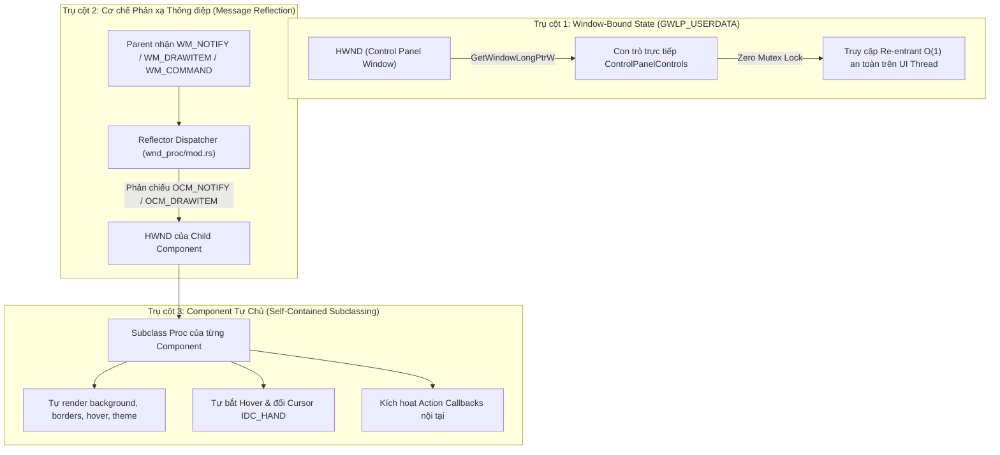
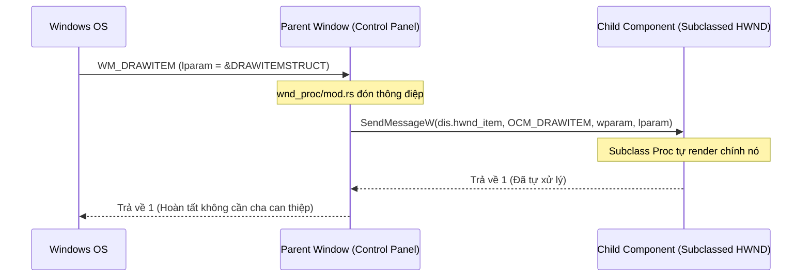

# Kiến trúc UI Component Độc lập (Win32 Native Component Architecture)

Tài liệu này quy chuẩn toàn bộ kiến trúc lập trình giao diện người dùng (UI Component) của dự án **Kora**, đóng vai trò là kim chỉ nam thiết kế và tiêu chuẩn kỹ thuật để đội ngũ phát triển rà soát, mở rộng hoặc viết thêm bất kỳ UI Component nào trong tương lai.

---

## 1. Bối cảnh & Vấn đề Cần Giải Quyết

Trong lập trình ứng dụng native trên hệ điều hành Windows (Win32 API) bằng Rust, kiến trúc UI thường gặp phải 2 nút thắt kinh điển nếu không được thiết kế chuẩn ngay từ tầng base:

```
[Mô hình cũ có lỗi thiết kế]
Windows Event (WM_NOTIFY / WM_DRAWITEM / WM_COMMAND)
       │
       ▼
control_panel_wnd_proc
       │
       ├── [NÚT THẮT 1] Phụ thuộc Global Mutex: UI_MANAGER.try_lock()
       │   └── Khi các thông điệp vẽ đệ quy (re-entrant), lock bị nghẽn (WouldBlock),
       │       dẫn đến rớt frame vẽ (phải hover chuột vào nút thì nó mới chịu hiện màu).
       │
       └── [NÚT THẮT 2] Rò rỉ Logic Con ra Cửa Sổ Cha (God Object)
           └── control_panel/mod.rs và từng file tab phải ôm đồm việc kiểm tra ID,
               tự ép kiểu con trỏ, tự gọi render với màu sắc tương ứng.
```

### Hậu quả của kiến trúc cũ:
1. **Mã nguồn bị ghép nối chặt (Tight Coupling):** Thêm một nút hay một bảng mới đòi hỏi lập trình viên phải sửa ở 3-4 file (`wnd_proc/mod.rs`, `control_panel/mod.rs`, `tab_*.rs`).
2. **Khó bảo trì và dễ vỡ:** Vi phạm nguyên lý Đơn trách nhiệm (Single Responsibility Principle). Cửa sổ cha biến thành "God Object" chứa hàng trăm dòng mã vẽ chi tiết của các control con.
3. **Hiện tượng giật/lỗi vẽ (UI Flickering / Missing Redraw):** Do phụ thuộc vào Mutex trong vòng lặp thông điệp chính.

---

## 2. Ba Trụ Cột Kiến Trúc Chuẩn

Kiến trúc mới áp dụng triết lý thiết kế của các UI framework Win32 chuyên nghiệp (MFC, WTL, Chromium Win32 backend), dựa trên **3 Trụ cột cốt lõi**:



---

### Trụ cột 1: Window-Bound State (`GWLP_USERDATA`)

Thay vì bọc toàn bộ cấu trúc UI trong một `Mutex<Option<UIManager>>` toàn cục và cố gắng gọi `try_lock()` trong Window Procedure, con trỏ trạng thái UI được gắn trực tiếp vào handle cửa sổ thông qua API Win32:

```rust
// Khi tạo cửa sổ chính (src/ui/mod.rs):
SetWindowLongPtrW(h_panel, GWLP_USERDATA, &ui.controls as *const _ as isize);

// Trong Window Procedure (src/ui/wnd_proc/mod.rs):
let ptr = GetWindowLongPtrW(hwnd, GWLP_USERDATA) as *const ControlPanelControls;
let controls = if ptr.is_null() { None } else { Some(&*ptr) };
```

#### Ưu điểm:
- **Tốc độ truy xuất \(O(1)\):** Không qua bất kỳ cấu trúc bảng băm (hashmap) hay cơ chế tra cứu phức tạp nào.
- **Zero-Lock & Hoàn toàn Re-entrant:** Không bao giờ bị chặn (`WouldBlock`) khi Windows gửi các thông điệp vẽ đệ quy (như `WM_PAINT` sinh ra `WM_DRAWITEM` hoặc `WM_NCPAINT`).
- **An toàn tuyệt đối:** Vòng đời của dữ liệu gắn liền với vòng đời cửa sổ Win32, chỉ thao tác trên UI Thread (STA model).

---

### Trụ cột 2: Cơ chế Phản xạ Thông điệp (`Message Reflection - OCM_*`)

Trong thiết kế Win32 nguyên bản, các control tiêu chuẩn (Button, ComboBox, ListView) khi cần vẽ hoặc có tương tác sẽ gửi thông điệp **lên cửa sổ cha** (`WM_COMMAND`, `WM_DRAWITEM`, `WM_NOTIFY`, `WM_MEASUREITEM`, `WM_CTLCOLOR*`).

Cơ chế **Message Reflection** khắc phục điều này bằng cách định nghĩa dải thông điệp phản xạ:
$$\text{OCM\_BASE} = \text{WM\_USER} + 0x1C00 = 0x2000$$

Khi cửa sổ cha nhận được thông điệp từ control con, nó lập tức gửi ngược lại chính handle (`hwnd_from` hoặc `hwnd_item`) của control đó kèm dải mã `OCM_*`:

```rust
// Định nghĩa tại src/ui/win32.rs
pub const OCM_BASE: u32 = 0x2000;
pub const OCM_COMMAND: u32 = OCM_BASE + 0x0111;     // Phản xạ WM_COMMAND
pub const OCM_DRAWITEM: u32 = OCM_BASE + 0x002B;    // Phản xạ WM_DRAWITEM
pub const OCM_MEASUREITEM: u32 = OCM_BASE + 0x002C; // Phản xạ WM_MEASUREITEM
pub const OCM_NOTIFY: u32 = OCM_BASE + 0x004E;      // Phản xạ WM_NOTIFY
```

#### Luồng phản xạ thông điệp:



---

### Trụ cột 3: Chuẩn Component Tự Chủ (Self-Contained Components)

Mỗi component sở hữu một hàm Subclass Window Procedure (`SetWindowSubclass`), tự quản lý vòng đời bộ nhớ, trạng thái chuột và phong cách vẽ:

1. **Quản lý bộ nhớ an toàn (`Arc<Mutex<ComponentData>>`):** Con trỏ state được chuyển thành raw pointer (`Arc::into_raw`) gắn vào `ref_data` của Subclass. Khi nhận `WM_NCDESTROY`, component tự thu hồi bộ nhớ bằng `Arc::from_raw`.
2. **Tự động theo dõi chuột (Hover Tracking):** Sử dụng `TrackMouseEvent` với cờ `TME_LEAVE` để nhận biết chính xác khi nào chuột rời khỏi control và gọi `InvalidateRect`.
3. **Tự quản lý con trỏ (Hand Cursor):** Xử lý `WM_SETCURSOR` để hiển thị con trỏ bàn tay `IDC_HAND` mượt mà khi hover vào các vùng tương tác.
4. **Tự render theo Theme:** Khi nhận `OCM_DRAWITEM` hoặc `OCM_NOTIFY`, component tự đọc `crate::ui::is_current_dark()` và lấy bảng màu chuẩn `ThemePalette` để tự vẽ viền, nền, chữ, bo góc.

---

## 3. Danh sách các Component đã Chuẩn Hóa

| Component | File Nguồn | Trách Nhiệm Tự Chủ |
| :--- | :--- | :--- |
| **`ActionTable`** | [`src/ui/components/action_table.rs`](file:///c:/Users/uongsuadaubung/Desktop/kora/src/ui/components/action_table.rs) | Bảng dữ liệu tương tác hiện đại. Tự xử lý `OCM_NOTIFY`, vẽ các nút hành động (Sửa, Xóa) trong từng cell, tự bắt hover đổi `IDC_HAND`, tự kích hoạt callback `on_edit` và `on_delete`. |
| **`PushButton`** | [`src/ui/components/button.rs`](file:///c:/Users/uongsuadaubung/Desktop/kora/src/ui/components/button.rs) | Nút bấm Fluent Design. Tự xử lý `OCM_DRAWITEM`, hỗ trợ các biến thể (`Primary`, `Secondary`, `Danger`), tự đổi màu khi hover/pressed/disabled, tự bo góc và đặt con trỏ tay. |
| **`ListView`** | [`src/ui/components/listview.rs`](file:///c:/Users/uongsuadaubung/Desktop/kora/src/ui/components/listview.rs) | Bảng danh sách Win32 SysListView32. Tự xử lý `OCM_NOTIFY` (`NM_CUSTOMDRAW`), tự tô màu dòng được chọn (`CDRF_NEWFONT`) theo theme mà không cần cửa sổ cha can thiệp. |
| **`ListBox`** | [`src/ui/components/listbox.rs`](file:///c:/Users/uongsuadaubung/Desktop/kora/src/ui/components/listbox.rs) | Danh sách lựa chọn hiện đại (Owner-Draw). Tự xử lý `OCM_DRAWITEM` và `OCM_MEASUREITEM`, vẽ item bo góc, hover, selection badge Fluent. |
| **`ComboBox`** | [`src/ui/components/combobox.rs`](file:///c:/Users/uongsuadaubung/Desktop/kora/src/ui/components/combobox.rs) | Hộp thả chọn hiện đại. Tự nhận diện và vẽ item qua `OCM_DRAWITEM`. Không còn tình trạng phải subclass ngược cửa sổ cha. |
| **`CheckBox`** | [`src/ui/components/checkbox.rs`](file:///c:/Users/uongsuadaubung/Desktop/kora/src/ui/components/checkbox.rs) | Hộp kiểm tự vẽ Fluent 18x18, căn giữa hoàn hảo, tự bắt hover và cập nhật trạng thái độc lập. |
| **`TextBox`** | [`src/ui/components/textbox.rs`](file:///c:/Users/uongsuadaubung/Desktop/kora/src/ui/components/textbox.rs) | Hộp nhập văn bản đa tầng (Container Subclass + Inner Edit Subclass), tự vẽ đường viền Fluent và xử lý focus. |
| **`Label`** | [`src/ui/components/label.rs`](file:///c:/Users/uongsuadaubung/Desktop/kora/src/ui/components/label.rs) | Nhãn văn bản Win32 tĩnh hỗ trợ cập nhật text an toàn (`set_text`). Đã đổi tên chuẩn xác từ `group_box.rs` cũ. |
| **`TabBar`** | [`src/ui/components/tab_bar.rs`](file:///c:/Users/uongsuadaubung/Desktop/kora/src/ui/components/tab_bar.rs) | Thanh chuyển tab tuỳ biến hiện đại, tự vẽ indicator hoạt họa và bắt chuyển tab. |
| **`Slider`** | [`src/ui/components/slider.rs`](file:///c:/Users/uongsuadaubung/Desktop/kora/src/ui/components/slider.rs) | Thanh trượt Trackbar native Win32 kèm nhãn giá trị động. |

---

## 4. Hướng Dẫn Hiện Thực Component Mới (Step-by-Step Guide)

Khi xây dựng một UI component mới (ví dụ: `ColorPicker`, `TagList`, `ProgressBar`), hãy tuân thủ nghiêm ngặt quy trình 5 bước sau:

### Bước 1: Khai báo Cấu trúc Dữ liệu Component
Tạo struct chứa dữ liệu nội tại và struct đại diện cho Component:

```rust
use std::sync::{Arc, Mutex};

pub struct MyComponentData {
    pub is_hover: bool,
    pub accent_color: u32,
    pub on_change: Option<Arc<dyn Fn(i32) + Send + Sync>>,
}

pub struct MyComponent {
    hwnd: isize,
    id: u32,
    state: Arc<Mutex<MyComponentData>>,
}
```

### Bước 2: Viết Subclass Window Procedure
Xử lý các thông điệp phản chiếu `OCM_*` và thông điệp chuột/hủy cửa sổ:

```rust
const MY_COMPONENT_SUBCLASS_ID: usize = 0x601;

unsafe extern "system" fn my_component_subclass_proc(
    hwnd: isize,
    msg: u32,
    wparam: usize,
    lparam: isize,
    uid_subclass: usize,
    ref_data: usize,
) -> isize {
    let state_ptr = ref_data as *const Mutex<MyComponentData>;
    if state_ptr.is_null() {
        return DefSubclassProc(hwnd, msg, wparam, lparam);
    }
    let state_arc = &*state_ptr;

    match msg {
        WM_NCDESTROY => {
            RemoveWindowSubclass(hwnd, my_component_subclass_proc, uid_subclass);
            drop(Arc::from_raw(state_ptr)); // Thu hồi bộ nhớ an toàn
            DefSubclassProc(hwnd, msg, wparam, lparam)
        }
        WM_SETCURSOR => {
            SetCursor(LoadCursorW(0, IDC_HAND));
            1
        }
        WM_MOUSEMOVE => {
            // Đăng ký TrackMouseEvent để đón WM_MOUSELEAVE
            // Cập nhật state.is_hover và InvalidateRect nếu thay đổi
            DefSubclassProc(hwnd, msg, wparam, lparam)
        }
        OCM_DRAWITEM => {
            // Tự vẽ giao diện từ DRAWITEMSTRUCT theo ThemePalette
            1 // Trả về 1 để báo hiệu đã xử lý xong
        }
        OCM_NOTIFY => {
            // Tự xử lý NM_CUSTOMDRAW hoặc sự kiện thông báo nội bộ
            DefSubclassProc(hwnd, msg, wparam, lparam)
        }
        _ => DefSubclassProc(hwnd, msg, wparam, lparam),
    }
}
```

### Bước 3: Hàm Khởi Tạo (`create`)
Tạo window native Win32 và đăng ký Subclass với `ref_data`:

```rust
impl MyComponent {
    pub fn create(parent: isize, id: u32, x: i32, y: i32, w: i32, h: i32) -> Option<Self> {
        let hwnd = unsafe {
            CreateWindowExW(
                0,
                to_wide("BUTTON").as_ptr(), // hoặc class tương ứng
                null_mut(),
                WS_CHILD | WS_VISIBLE | WS_TABSTOP | BS_OWNERDRAW,
                x, y, w, h,
                parent,
                id as isize,
                0,
                null_mut(),
            )
        };
        if hwnd == 0 {
            return None;
        }

        let state = Arc::new(Mutex::new(MyComponentData {
            is_hover: false,
            accent_color: 0x0078D4,
            on_change: None,
        }));

        let state_raw = Arc::into_raw(state.clone()) as usize;
        unsafe {
            SetWindowSubclass(hwnd, my_component_subclass_proc, MY_COMPONENT_SUBCLASS_ID, state_raw);
        }

        Some(Self { hwnd, id, state })
    }
}
```

### Bước 4: Khai báo API Thay Đổi Trạng Thái
Cung cấp các hàm an toàn để cập nhật thuộc tính từ bên ngoài:

```rust
impl MyComponent {
    pub fn set_accent_color(&self, color: u32) {
        if let Ok(mut s) = self.state.lock() {
            s.accent_color = color;
        }
        unsafe {
            InvalidateRect(self.hwnd, null_mut(), 0);
        }
    }
}
```

---

## 5. Quy Tắc & Tiêu Chuẩn Lập Trình (Do's & Don'ts)

### Những điều BẮT BUỘC (Do's)
1. **Luôn sử dụng Message Reflection:** Đón sự kiện tại subclass của chính control con thông qua `OCM_*`.
2. **Giải phóng tài nguyên GDI triệt để:** Bất kỳ GDI Object nào tạo ra (`CreateSolidBrush`, `CreatePen`, `CreateFontW`) đều phải gọi `DeleteObject` ngay sau khi sử dụng xong trong chu kỳ vẽ.
3. **Hoàn nguyên Object vào DC:** Khi dùng `SelectObject(hdc, new_brush)`, phải lưu `old_brush` và `SelectObject(hdc, old_brush)` trước khi hủy.
4. **Luôn cập nhật theo theme:** Sử dụng `crate::ui::is_current_dark()` và `ThemePalette::get(is_dark)` thay vì hardcode mã màu hex.

### Những điều TUYỆT ĐỐI TRÁNH (Don'ts)
1. **CẤM dùng Mutex Lock chặn chu kỳ vẽ:** Tuyệt đối không gọi các hàm block như `lock().unwrap()` trên các Mutex cấp cao của Engine/UI bên trong subclass proc hay Window Procedure của Win32.
2. **CẤM viết mã vẽ của control con trong cửa sổ cha:** `control_panel/mod.rs` chỉ đóng vai trò layout container sắp xếp vị trí và điều hướng view, không được chứa mã tô màu hay custom draw cho từng control cụ thể.
3. **CẤM bỏ quên `WM_NCDESTROY`:** Luôn phải dọn dẹp subclass và giải phóng con trỏ raw pointer khi cửa sổ con bị hủy để tránh memory leak.

---

## 6. Chuẩn Hóa Cấu Trúc Thư Mục Phân Hệ UI (`src/ui/`)

Phân hệ UI được tổ chức theo cấu trúc phân tầng rõ ràng, loại bỏ hoàn toàn các misnomer (tên gọi sai lệch), dead code và logic phân mảnh:

```
src/ui/
├── mod.rs                        # Khởi tạo cửa sổ UI chính, đăng ký Window Class
├── win32.rs                      # Toàn bộ Win32 FFI bindings, types, constants & OCM_* reflection
├── theme.rs                      # Dark/Light theme mode, ThemePalette, brush caching
├── colors.rs                     # Định nghĩa mã màu và hằng số giao diện
├── tokens.rs                     # Design tokens (spacing, typography, border radius)
│
├── components/                   # BỘ THƯ VIỆN UI COMPONENT TỰ CHỦ (Không chứa logic nghiệp vụ)
│   ├── mod.rs                    # Re-export các component
│   ├── action_table.rs           # ActionTable (bảng tương tác với nút inline Sửa/Xóa)
│   ├── button.rs                 # PushButton (Primary, Secondary, Danger, Fluent hover)
│   ├── checkbox.rs               # CheckBox (Fluent 18x18, owner-draw)
│   ├── combobox.rs               # ComboBox (Owner-draw dropdown)
│   ├── label.rs                  # Label (Nhãn văn bản, đã đổi tên chuẩn từ group_box.rs)
│   ├── listbox.rs                # ListBox (Owner-draw modern item selection)
│   ├── listview.rs               # ListView (Win32 SysListView32 + CustomDraw)
│   ├── menu.rs                   # Context Menu popup helpers
│   ├── slider.rs                 # Slider Trackbar
│   ├── tab_bar.rs                # Modern tab selector with indicator
│   └── textbox.rs                # TextBox (Dual-subclass fluent border text input)
│
├── views/                        # CÁC MÀN HÌNH VÀ HỘP THOẠI NGHIỆP VỤ
│   ├── mod.rs                    # Re-export views và dialogs (đảm bảo backwards-compatibility)
│   ├── control_panel/            # Cửa sổ Control Panel chính
│   │   ├── mod.rs                # Container chính: điều hướng, tab switching, layout
│   │   ├── paint.rs              # Gradient & border painting riêng của Control Panel
│   │   ├── banner.rs             # Header status banner (Bật/Tắt, Active Profile)
│   │   ├── sidebar.rs            # Left navigation sidebar & profile selector
│   │   ├── footer.rs             # Nút Reset / Save / Close
│   │   ├── tab_typing.rs         # Tab Bộ gõ tiếng Việt
│   │   ├── tab_remap.rs          # Tab Phím tắt & Remap (đổi tên từ tab_remap_disable.rs)
│   │   ├── tab_macro.rs          # Tab Quản lý phím gõ tắt (Macro)
│   │   ├── tab_sound.rs          # Tab Âm thanh gõ phím
│   │   ├── tab_system.rs         # Tab Cấu hình hệ thống (Khởi động, ngôn ngữ, cập nhật)
│   │   └── tab_about.rs          # Tab Giới thiệu phần mềm & tác giả
│   │
│   └── dialogs/                  # HỘP THOẠI MODAL (Tách biệt khỏi view chính)
│       ├── mod.rs                # Re-export các hàm show_*_dialog
│       ├── add_profile.rs        # Hộp thoại tạo profile mới
│       ├── remap_key.rs          # Hộp thoại gán phím (Remap Key)
│       ├── disable_key.rs        # Hộp thoại vô hiệu hóa phím (Disable Key)
│       ├── hotkey.rs             # Hộp thoại ghi nhận tổ hợp phím tắt (Hotkey capture)
│       └── macro_editor.rs       # Hộp thoại thêm/sửa từ gõ tắt (Macro Editor)
│
├── tray/                         # PHÂN HỆ SYSTEM TRAY (Gom cụm độc lập)
│   ├── mod.rs                    # Re-export TrayIcon, load_icon_from_rc, handle_tray_menu
│   ├── icon.rs                   # Wrapper NOTIFYICONDATAW Win32 API
│   ├── loader.rs                 # Nạp icon từ PE resource (.ico/.rc)
│   └── handler.rs                # Xử lý context menu khay hệ thống (Click, Thoát, Mở UI)
│
└── wnd_proc/                     # WINDOW PROCEDURES & MESSAGE DISPATCHING
    ├── mod.rs                    # Window Procedure chính + Message Reflection Dispatcher
    ├── commands.rs               # Xử lý WM_COMMAND và routing sự kiện menu
    ├── colors.rs                 # Xử lý WM_CTLCOLORSTATIC, WM_CTLCOLORDLG cho dark theme
    └── tray.rs                   # Xử lý thông điệp khay hệ thống WM_TRAYICON
```

