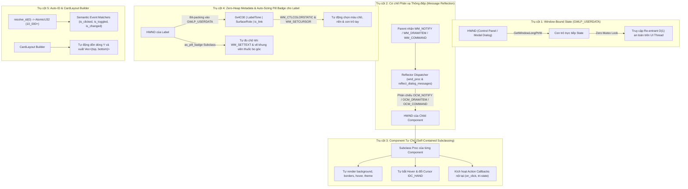
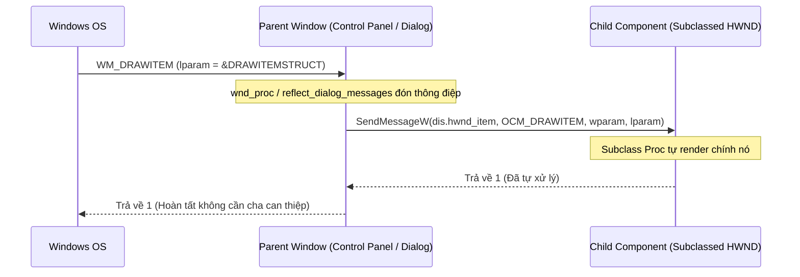

# Kiến trúc UI Component Độc lập (Win32 Native Component Architecture)

Tài liệu này quy chuẩn kiến trúc nền tảng của phân hệ giao diện người dùng (UI Component) trong dự án **Kora**, giải thích cơ chế hoạt động bên dưới tầng Win32 API và cách thiết kế một UI Component mới.

> Để tra cứu API và cách gọi từng component khi ghép giao diện (tạo Tab, Dialog), xem tài liệu riêng: **[`docs/UI_COMPONENT_GUIDE.md`](file:///c:/Users/kien.hm/Desktop/OpenKey/docs/UI_COMPONENT_GUIDE.md)**.

---

## 1. Bối cảnh & Vấn đề Cần Giải Quyết

Trong lập trình ứng dụng native trên hệ điều hành Windows (Win32 API) bằng Rust, kiến trúc UI thường gặp phải 3 nút thắt kinh điển nếu không được thiết kế chuẩn ngay từ tầng base:

```
[Mô hình cũ có lỗi thiết kế]
Windows Event (WM_NOTIFY / WM_DRAWITEM / WM_COMMAND / WM_CTLCOLORSTATIC)
       │
       ▼
control_panel_wnd_proc
       │
       ├── [NÚT THẮT 1] Phụ thuộc Global Mutex: UI_MANAGER.try_lock()
       │   └── Khi các thông điệp vẽ đệ quy (re-entrant), lock bị nghẽn (WouldBlock),
       │       dẫn đến rớt frame vẽ (phải hover chuột vào nút thì nó mới chịu hiện màu).
       │
       ├── [NÚT THẮT 2] Rò rỉ Logic Con ra Cửa Sổ Cha (God Object)
       │   └── control_panel/mod.rs và từng file tab phải ôm đồm việc kiểm tra ID,
       │       tự ép kiểu con trỏ, tự gọi render với màu sắc tương ứng.
       │
       └── [NÚT THẮT 3] Component bị gắn chặt với dữ liệu nghiệp vụ & hằng số IDC_*
           └── Component tự đọc cấu hình ngôn ngữ toàn cục hoặc bắt từng Tab phải
               khai báo hàng chục hằng số IDC_* và tính toạ độ Y thủ công.
```

---

## 2. Năm Trụ Cột Kiến Trúc Chuẩn

Kiến trúc UI của Kora áp dụng triết lý thiết kế của các UI framework Win32 chuyên nghiệp (WTL, Chromium Win32 backend), dựa trên **5 Trụ cột cốt lõi**:



---

### Trụ cột 1: Window-Bound State (`GWLP_USERDATA`)

Thay vì bọc toàn bộ cấu trúc UI trong một `Mutex<Option<UIManager>>` toàn cục và cố gắng gọi `try_lock()` trong Window Procedure, con trỏ trạng thái UI được truy xuất thông qua Thread-Local UI state kết hợp fallback `GWLP_USERDATA`:

```rust
// Khi tạo cửa sổ chính (src/ui/mod.rs):
SetWindowLongPtrW(h_panel, GWLP_USERDATA, &ui.controls as *const _ as isize);

// Trong Window Procedure (src/ui/wnd_proc/mod.rs):
let controls = crate::ui::controls().or_else(|| {
    let ptr = GetWindowLongPtrW(hwnd, GWLP_USERDATA) as *const ControlPanelControls;
    (!ptr.is_null()).then(|| &*ptr)
});
```

#### Ưu điểm:
- **Tốc độ truy xuất $O(1)$:** Không qua bất kỳ cấu trúc bảng băm (hashmap) hay cơ chế tra cứu phức tạp nào.
- **Zero-Lock & Hoàn toàn Re-entrant:** Không bao giờ bị chặn (`WouldBlock`) khi Windows gửi các thông điệp vẽ đệ quy (như `WM_PAINT` sinh ra `WM_DRAWITEM` hoặc `WM_CTLCOLORSTATIC`).
- **An toàn tuyệt đối:** Vòng đời của dữ liệu gắn liền với vòng đời cửa sổ Win32, chỉ thao tác trên UI Thread (STA model).

---

### Trụ cột 2: Cơ chế Phản xạ Thông điệp (`Message Reflection - OCM_*`)

Trong thiết kế Win32 nguyên bản, các control tiêu chuẩn (Button, ComboBox, ListBox) khi cần vẽ hoặc có tương tác sẽ gửi thông điệp **lên cửa sổ cha** (`WM_COMMAND`, `WM_DRAWITEM`, `WM_NOTIFY`, `WM_MEASUREITEM`).

Cơ chế **Message Reflection** khắc phục điều này bằng cách định nghĩa dải thông điệp phản xạ:
$$\text{OCM\_BASE} = \text{WM\_USER} + 0x1C00 = 0x2000$$

Khi cửa sổ cha (Control Panel hoặc bất kỳ Modal Dialog nào thông qua [`reflect_dialog_messages`](file:///c:/Users/kien.hm/Desktop/OpenKey/src/ui/views/dialogs/mod.rs)) nhận được thông điệp từ control con, nó lập tức gửi ngược lại chính handle (`hwnd_from`, `hwnd_item` hoặc `lparam`) của control đó kèm dải mã `OCM_*`:

```rust
// Định nghĩa tại src/ui_framework/win32/types.rs
pub const OCM_BASE: u32 = 0x2000;
pub const OCM_COMMAND: u32 = OCM_BASE + 0x0111;      // Phản xạ WM_COMMAND
pub const OCM_DRAWITEM: u32 = OCM_BASE + 0x002B;     // Phản xạ WM_DRAWITEM
pub const OCM_MEASUREITEM: u32 = OCM_BASE + 0x002C;  // Phản xạ WM_MEASUREITEM
pub const OCM_NOTIFY: u32 = OCM_BASE + 0x004E;       // Phản xạ WM_NOTIFY
pub const OCM_THEMECHANGED: u32 = OCM_BASE + 0x031A; // Phản xạ đổi Theme tự động cho mọi cửa sổ con
```

#### Luồng phản xạ thông điệp:



---

### Trụ cột 3: Chuẩn Component Tự Chủ (Self-Contained Components)

Mỗi component sở hữu một hàm Subclass Window Procedure (`SetWindowSubclass`) hoặc Custom Window Class riêng, tự quản lý vòng đời bộ nhớ, trạng thái chuột và phong cách vẽ:

1. **Quản lý bộ nhớ an toàn (`Arc<Mutex<ComponentData>>` hoặc `Box<State>`):** Con trỏ state được gắn vào `ref_data` của Subclass hoặc `GWLP_USERDATA`. Khi nhận `WM_NCDESTROY`, component tự thu hồi bộ nhớ.
2. **Tự động theo dõi chuột (Hover Tracking):** Sử dụng `TrackMouseEvent` với cờ `TME_LEAVE` để nhận biết chính xác khi nào chuột rời khỏi control và gọi `InvalidateRect`.
3. **Tự quản lý con trỏ (Hand Cursor):** Xử lý `WM_SETCURSOR` để hiển thị con trỏ bàn tay `IDC_HAND` mượt mà khi hover vào các vùng tương tác.
4. **Tự render & đồng bộ Theme (`OCM_THEMECHANGED`):** Khi nhận `OCM_DRAWITEM`, `WM_PAINT` hoặc `OCM_THEMECHANGED` (do `apply_window_theme` phát xuống toàn bộ cây cửa sổ con qua `EnumChildWindows`), component tự đọc `is_current_dark()` và lấy bảng màu chuẩn `ThemePalette` để tự cập nhật màu sắc và vẽ lại mà tầng ứng dụng không cần can thiệp.
5. **Tự xử lý hành vi nội tại qua `OCM_COMMAND`:** `CheckBox` tự đảo trạng thái 2-state/3-state và `PushButton` tự kích hoạt closure `on_click` ngay khi nhận `OCM_COMMAND`.

---

### Trụ cột 4: Zero-Heap Metadata & Auto-Sizing Pill Badge cho `Label`

Đối với các control tĩnh nhẹ như `Label` (`STATIC`), việc cấp phát heap cho hàng trăm nhãn là không cần thiết. Kora sử dụng kỹ thuật **Bit-packing vào `GWLP_USERDATA`**:
- Byte cao chứa magic tag `0x4C00` để nhận diện đây là một `Label` có gắn metadata.
- Các bit thấp lưu `LabelTone` (màu chữ), `SurfaceRole` (màu nền chứa nhãn), và cờ `is_link`.
- Khi cửa sổ cha nhận `WM_CTLCOLORSTATIC` hoặc `WM_SETCURSOR`, [`ctlcolor.rs`](file:///c:/Users/kien.hm/Desktop/OpenKey/src/ui_framework/win32/ctlcolor.rs) giải mã trực tiếp `GWLP_USERDATA` của `hwnd_ctrl` để cấp đúng màu chữ, brush nền và con trỏ `IDC_HAND`.
- Với các nhãn cần đóng khung huy hiệu phím bấm (`.as_pill_badge(min_w, max_w)`), `Label` đăng ký một Subclass zero-heap (đóng gói `min_w` và `max_w` trực tiếp vào 32-bit `ref_data`), tự động đo lại kích thước chuỗi bằng `GetTextExtentPoint32W` mỗi khi nhận `WM_SETTEXT`, tự co giãn chiều rộng `HWND` bằng `SetWindowPos`, và tự vẽ khung bo góc `RoundRect` trong `WM_PAINT`.

---

### Trụ cột 5: Auto-ID (`resolve_id`), `ComponentHandle` & `CardLayout` Container

1. **Auto-ID (`resolve_id(0)`) & `ComponentHandle`**:
   - Trong [`src/ui_framework/components/mod.rs`](file:///c:/Users/kien.hm/Desktop/OpenKey/src/ui_framework/components/mod.rs), bộ cấp phát `next_control_id()` sử dụng `AtomicU32` bắt đầu từ `10_000`.
   - Mọi component đều cài đặt trait `ComponentHandle` (`fn hwnd(&self) -> isize`), cho phép các bộ quản lý bố cục thao tác đồng nhất trên toàn bộ control.
   - Tầng View và toàn bộ 7 Modal Dialog đối chiếu sự kiện thông qua các phương thức ngữ nghĩa (`is_clicked`, `is_toggled`, `is_changed`, `parse_scroll`, `is_sel_changed`), loại bỏ 100% hằng số `IDC_*` thủ công trên toàn dự án.
2. **`CardLayout<S>` Container (`src/ui_framework/components/card_layout.rs`)**:
   - **Dàn trang dọc theo Typestate (`OutsideCard` $\leftrightarrow$ `InCard`) & vẽ khung Card tự động (`paint_cards`)**: Tính toán toạ độ `Y` lũy tiến theo từng dòng (`row(height, gap)`), khóa chặt vòng đời mở/đóng khối thẻ ở thời điểm biên dịch (`let mut ly = ly.begin_card()` / `let ly = ly.end_card()`), và tự vẽ toàn bộ nền/viền Card qua `self.layout.paint_cards(hdc, right_bound)`.
   - **1-Line Row & Zero-Coordinate Builders**: Cung cấp `page_header`, `section_title`, `label_row`, `checkbox_row`, `inheritable_checkbox_row`, `two_col_combos`, và nhóm khởi tạo không toạ độ `label`, `button`, `checkbox`, `inheritable_checkbox`, `combo` kết hợp với các bộ bố cục `horizontal`, `vertical`, `grid`, `form`, `split` giúp loại bỏ hoàn toàn việc tính toán toạ độ thủ công.
   - **Auto-HWND Tracking (`track`, `set_visible`)**: Tự động thu thập `HWND` của mọi component trong Tab/Sub-tab để ẩn/hiện đồng loạt mà không cần liệt kê mảng thủ công.
   - **Zero-Box Auto-I18n Binding (`track_i18n`, `track_combo_i18n`, `track_table_i18n`, `update_language`)**: Lưu các con trỏ hàm tĩnh `fn(&LanguageStrings) -> ...` (không tốn cấp phát heap `Box<dyn Fn>`), tự động cập nhật văn bản đa ngôn ngữ cho cả `Label`, `PushButton`, `CheckBox`, danh sách mục của `ComboBox` lẫn tiêu đề cột của `ActionTable` chỉ bằng một lời gọi `layout.update_language(strings)`.

---

## 3. Hướng Dẫn Thiết Kế & Hiện Thực Component Mới

Khi cần xây dựng một loại UI component hoàn toàn mới trong `src/ui_framework/components/` (ví dụ: `ColorPicker`, `ProgressBar`), hãy tuân thủ quy trình 4 bước sau:

### Bước 1: Khai báo Cấu trúc Dữ liệu Component
Tạo struct chứa trạng thái nội tại (tách biệt hoàn toàn khỏi dữ liệu nghiệp vụ của ứng dụng):

```rust
use std::sync::{Arc, Mutex};

pub struct MyComponentData {
    pub is_hover: bool,
    pub accent_color: u32,
    pub on_change: Option<Arc<dyn Fn(i32) + Send + Sync>>,
}

pub struct MyComponent {
    hwnd: isize,
    id: u32,
    state: Arc<Mutex<MyComponentData>>,
}
```

### Bước 2: Viết Subclass Window Procedure
Xử lý các thông điệp phản chiếu `OCM_*` và thông điệp chuột/hủy cửa sổ:

```rust
const MY_COMPONENT_SUBCLASS_ID: usize = 0x601;

unsafe extern "system" fn my_component_subclass_proc(
    hwnd: isize,
    msg: u32,
    wparam: usize,
    lparam: isize,
    uid_subclass: usize,
    ref_data: usize,
) -> isize {
    let state_ptr = ref_data as *const Mutex<MyComponentData>;
    if state_ptr.is_null() {
        return DefSubclassProc(hwnd, msg, wparam, lparam);
    }
    let state_arc = &*state_ptr;

    match msg {
        WM_NCDESTROY => {
            RemoveWindowSubclass(hwnd, my_component_subclass_proc, uid_subclass);
            drop(Arc::from_raw(state_ptr)); // Thu hồi bộ nhớ an toàn
            DefSubclassProc(hwnd, msg, wparam, lparam)
        }
        WM_SETCURSOR => {
            SetCursor(LoadCursorW(0, IDC_HAND));
            1
        }
        WM_MOUSEMOVE => {
            // Đăng ký TrackMouseEvent để đón WM_MOUSELEAVE
            // Cập nhật state.is_hover và InvalidateRect nếu thay đổi
            DefSubclassProc(hwnd, msg, wparam, lparam)
        }
        OCM_DRAWITEM => {
            // Tự vẽ giao diện từ DRAWITEMSTRUCT theo ThemePalette
            1 // Trả về 1 để báo hiệu đã xử lý xong
        }
        _ => DefSubclassProc(hwnd, msg, wparam, lparam),
    }
}
```

### Bước 3: Hàm Khởi Tạo (`create`) hỗ trợ `resolve_id(id)`
Tạo window native Win32, dùng `super::resolve_id(id)` để hỗ trợ `id = 0`, và đăng ký Subclass với `ref_data`:

```rust
impl MyComponent {
    pub fn create(parent: isize, id: u32, x: i32, y: i32, w: i32, h: i32) -> Option<Self> {
        let id = super::resolve_id(id);
        let hwnd = unsafe {
            CreateWindowExW(
                0,
                to_wide("BUTTON").as_ptr(),
                null_mut(),
                WS_CHILD | WS_VISIBLE | WS_TABSTOP | BS_OWNERDRAW,
                x, y, w, h,
                parent,
                id as isize,
                0,
                null_mut(),
            )
        };
        if hwnd == 0 {
            return None;
        }

        let state = Arc::new(Mutex::new(MyComponentData {
            is_hover: false,
            accent_color: 0x0078D4,
            on_change: None,
        }));

        let state_raw = Arc::into_raw(state.clone()) as usize;
        unsafe {
            SetWindowSubclass(hwnd, my_component_subclass_proc, MY_COMPONENT_SUBCLASS_ID, state_raw);
        }

        Some(Self { hwnd, id, state })
    }
}
```

### Bước 4: Cung cấp API Thay Đổi Trạng Thái & Semantic Event Matcher
Cung cấp các phương thức rõ ràng để tầng View truyền dữ liệu vào, đọc dữ liệu ra và kiểm tra sự kiện:

```rust
impl MyComponent {
    pub fn is_clicked(&self, ctrl_id: u32, notify_code: u32) -> bool {
        ctrl_id == self.id && notify_code == 0
    }

    pub fn set_accent_color(&self, color: u32) {
        if let Ok(mut s) = self.state.lock() {
            s.accent_color = color;
        }
        unsafe {
            InvalidateRect(self.hwnd, null_mut(), 0);
        }
    }
}
```

---

## 4. Quy Tắc & Tiêu Chuẩn Kỹ Thuật (Do's & Don'ts)

### Những điều BẮT BUỘC (Do's)
1. **Luôn sử dụng Message Reflection:** Đón sự kiện vẽ và tương tác nội bộ tại subclass của chính control con thông qua `OCM_*` (trong cả Control Panel và các Modal Dialog thông qua `reflect_dialog_messages`).
2. **Hỗ trợ Auto-ID (`resolve_id(id)`) và Semantic Event Matchers:** Mọi component nhận `id` đều phải gọi `super::resolve_id(id)` và cung cấp hàm kiểm tra sự kiện ngữ nghĩa (`is_clicked`, `is_changed`, ...).
3. **Giải phóng tài nguyên GDI triệt để:** Bất kỳ GDI Pen/Brush/Bitmap tạm nào tạo ra trong chu kỳ vẽ đều phải gọi `DeleteObject` ngay sau khi vẽ xong. Với Font chữ, luôn dùng `cached_font(size, weight)` từ `src/ui_framework/theme.rs`.
4. **Hoàn nguyên Object vào DC:** Khi dùng `SelectObject(hdc, new_obj)`, phải lưu `old_obj` và `SelectObject(hdc, old_obj)` trước khi hủy.
5. **Tách biệt dữ liệu nghiệp vụ:** Component trong `src/ui_framework/components/` không được phép đọc trực tiếp `CONFIG` hay `crate::language::current()` bên trong hàm vẽ `WM_PAINT`. Mọi chuỗi hiển thị phải được truyền vào qua tham số/state.

### Những điều TUYỆT ĐỐI TRÁNH (Don'ts)
1. **CẤM dùng Global Mutex chặn chu kỳ vẽ:** Không gọi lock trên các Mutex toàn cục của ứng dụng bên trong hàm vẽ của component.
2. **CẤM viết mã vẽ của control con trong cửa sổ cha:** `control_panel/mod.rs` và các file `tab_*.rs` chỉ vẽ khung Card nền qua `self.layout.paint_cards(hdc, right_bound)`, không vẽ đè lên từng control lẻ.
3. **CẤM bỏ quên `WM_NCDESTROY`:** Luôn thu hồi `Arc::from_raw` / `Box::from_raw` khi cửa sổ con bị hủy để tránh rò rỉ bộ nhớ.

---

## 5. Cấu Trúc Phân Tầng: `src/ui_framework/` & `src/ui/`

Hệ thống giao diện được tách biệt nghiêm ngặt thành **2 phân hệ độc lập**:

1. **`src/ui_framework/` (Tầng Nền tảng UI — Zero Engine Dependency):**
   Chịu trách nhiệm toàn bộ về Win32 FFI, GDI Drawing, Message Reflection (`OCM_*`), Theme/Font/Brush Cache, Modal Dialog Scaffold và 9 UI Component + `CardLayout`. Không chứa bất kỳ tham chiếu nào tới `crate::engine` hay `ControlPanelControls`.
2. **`src/ui/` (Tầng Tiêu thụ Ứng dụng — Application Consumer Layer):**
   Nơi lập trình viên xây dựng các màn hình nghiệp vụ (`views/control_panel/`, `views/dialogs/`), kết nối dữ liệu với `engine` qua `controller.rs` và xử lý khay hệ thống (`tray/`).

```
src/
├── ui_framework/                 # TẦNG NỀN TẢNG UI (Zero Business-Logic Dependency)
│   ├── mod.rs                    # Facade & `pub mod prelude` (1-line import cho tầng tiêu thụ)
│   ├── colors.rs                 # Bảng màu `ThemePalette` chuẩn Fluent Light / Dark
│   ├── tokens.rs                 # Design tokens thuần túy (typography, spacing, borders, radii, layout)
│   ├── theme.rs                  # Quản lý trạng thái Dark/Light, cached_font, GDI brush cache, apply_window_theme
│   ├── dialog.rs                 # Modal Dialog Framework (open_modal, reflect_dialog_messages, GDI painters)
│   ├── win32/                    # Tầng nền Win32 GUI FFI, Drawing, Reflection & CTLCOLOR
│   │   ├── mod.rs                # Module facade & re-exports
│   │   ├── types.rs              # Cấu trúc dữ liệu & constants GUI Win32 (OCM_* reflection)
│   │   ├── ffi.rs                # Win32 extern declarations & API wrappers
│   │   ├── draw.rs               # Tiện ích vẽ GDI & BackBuffer khử nhấp nháy
│   │   ├── font.rs               # Khởi tạo phông chữ GDI Segoe UI
│   │   ├── styling.rs            # DWM dark title bar, rounded corners & set_hwnds_visible
│   │   └── ctlcolor.rs           # Xử lý WM_CTLCOLOR*, WM_SETCURSOR tự động theo Class & Label metadata
│   └── components/               # Bộ 9 UI Component Tự Chủ + CardLayout
│       ├── mod.rs                # ComponentHandle trait, Auto-ID (resolve_id) & re-exports
│       ├── card_layout.rs        # CardLayout (Dàn trang dọc, 1-line Row Builders, Auto-HWND & Auto-I18n)
│       ├── button.rs             # PushButton & ButtonVariant (Double-buffered + on_click callback)
│       ├── checkbox.rs           # CheckBox (2-state & 3-state xoay vòng tự động)
│       ├── combobox.rs           # ComboBox (Owner-draw dropdown)
│       ├── label.rs              # Label (Zero-heap metadata + Link + Auto-sizing Pill Badge)
│       ├── listbox.rs            # ListBox (Owner-draw modern item selection)
│       ├── menu.rs               # PopupMenu (RAII HMENU wrapper)
│       ├── slider.rs             # Slider Trackbar (msctls_trackbar32 + parse_scroll + auto-theme)
│       ├── tab_bar.rs            # TabBar (Segmented pill bar)
│       ├── textbox.rs            # TextBox (Composite container + inner EDIT + custom placeholder)
│       └── action_table/         # ActionTable (Custom canvas table với badges & inline actions)
│
└── ui/                           # TẦNG TIÊU THỤ ỨNG DỤNG (Application Consumer Layer)
    ├── mod.rs                    # Khởi tạo cửa sổ Kora, quản lý UiState & re-export ui_framework
    ├── controller.rs             # Cầu nối đọc/ghi dữ liệu giữa UI và ENGINE_INSTANCE
    ├── theme.rs                  # 1-line bridge chuyển UiTheme của Engine sang apply_window_theme
    ├── tokens.rs                 # Re-export design tokens từ ui_framework (0 hằng số IDC_*)
    ├── views/                    # Các màn hình và hộp thoại nghiệp vụ của Kora
    │   ├── control_panel/        # Cửa sổ Control Panel chính và 6 Tab nghiệp vụ
    │   └── dialogs/              # 7 hộp thoại Modal chuẩn hóa với open_modal::<T> / open_client_modal::<T>
    ├── tray/                     # Phân hệ System Tray Icon & Context Menu
    └── wnd_proc/                 # Window Procedure chính của Control Panel & Tray Helper
```
