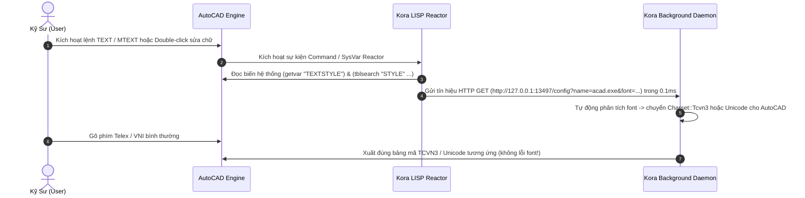

# Thiết Kế Tính Năng: Tự Động Nhận Diện Bảng Mã Trong AutoCAD (AutoLISP Sidecar)

> **Mục tiêu:** Tự động phát hiện kiểu font chữ (Font / TextStyle) của đối tượng văn bản đang được soạn thảo trong AutoCAD (`TEXT`, `MTEXT`, `DTEXT`, `DDEDIT`...) và tự động chuyển đổi bảng mã tương ứng (**Unicode** $\leftrightarrow$ **TCVN3**) trong Kora theo thời gian thực mà người dùng không cần bấm phím tắt hay thao tác thủ công.

---

## 1. Bối Cảnh Thực Tế & "Nỗi Đau" Của Dân Kỹ Thuật

Trong ngành xây dựng, kiến trúc, cơ khí và hạ tầng tại Việt Nam:
1. **Hồ sơ kỹ thuật cũ & quy chuẩn nhà nước:** Phần lớn bản vẽ tiêu chuẩn cũ, khung tên, ký hiệu trắc địa và ghi chú kỹ thuật đều dùng các font TCVN3 (ABC) như `.VnTime`, `.VnArial`, `.VnCourier` hoặc font vector hình học `.shx` (`tc.shx`, `vntime.shx`).
2. **Hồ sơ hiện đại & dự án quốc tế:** Các bản vẽ mới, block ghi chú hiện đại hoặc bản vẽ phối hợp BIM/Revit lại dùng font Unicode quốc tế (`Arial`, `Times New Roman`, `Tahoma`, `Open Sans`).
3. **Thực trạng làm việc hàng ngày:**
   - Kỹ sư liên tục mở nhiều bản vẽ khác nhau hoặc trong **cùng một bản vẽ** vừa phải sửa ghi chú cũ (TCVN3) vừa phải viết thuyết minh/kích thước mới (Unicode).
   - Với các bộ gõ truyền thống (Unikey, EVKey, OpenKey), kỹ sư phải liên tục nhớ bấm phím tắt (`Ctrl+Shift+F1` / `Ctrl+Shift+F2`) trước khi gõ chữ.
   - **Hậu quả:** Chỉ cần quên 1 lần, văn bản gõ ra sẽ biến thành chuỗi ký tự lỗi, dấu hỏi (`???`) hoặc ô vuông hỏng hóc, buộc phải xóa đi gõ lại từ đầu, làm gián đoạn mạch làm việc nghiêm trọng.

---

## 2. Vì Sao Các Bộ Gõ Hiện Nay Không Tự Nhận Diện Được?

- **Đối tượng đồ họa vector vs Ô văn bản hệ điều hành:**
  - Trong các ứng dụng văn phòng (Word, Notepad, Trình duyệt), ô nhập là Win32 control chuẩn (`EDIT`, `RichEdit`). Windows cung cấp tin nhắn `EM_GETCHARFORMAT` để bộ gõ bên ngoài đọc tên font `szFaceName`.
  - Trong AutoCAD, các dòng chữ (`TEXT`, `DTEXT`, `MTEXT`) là **các thực thể đồ họa vector (Vector Entities)** nằm trong cơ sở dữ liệu bản vẽ `.DWG`, được AutoCAD render trực tiếp lên viewport DirectX/OpenGL.
  - Windows OS và bộ gõ ngoài hoàn toàn "bị mù" đối với cấu trúc bên trong bản vẽ CAD. Khi người dùng click chuột vào một chữ trong CAD, Windows chỉ thấy con trỏ chuột tương tác với cửa sổ đồ họa chung (`AfxFrameOrView`).
- **Chìa khóa giải quyết:** Thay vì "đoán mò" từ bên ngoài, giải pháp tối ưu nhất là đặt một **Agent Sidecar cực nhẹ bên trong AutoCAD (qua AutoLISP)** để đọc trực tiếp bảng kiểu chữ (`STYLE`) và báo cho Kora qua kênh giao tiếp liên tiến trình siêu tốc (**Local IPC**).

---

## 3. Kiến Trúc Kora CAD Sidecar



---

## 4. Thiết Kế Phía AutoCAD: File Script `kora-cad.lsp`

AutoCAD hỗ trợ **Visual LISP (VLAX)** và cơ chế **Reactor** (bộ lắng nghe sự kiện nội bộ). File script hoàn chỉnh được đặt tại [`integrations/autocad/kora-cad.lsp`](file:///c:/Users/uongsuadaubung/Desktop/mkey/integrations/autocad/kora-cad.lsp).

### Các điểm kỹ thuật quan trọng trong AutoLISP:
1. **Lấy font TrueType (.VnTime, Arial...) qua XData**: Trong AutoCAD, font SHX lưu ở mã DXF 3, nhưng font TrueType lưu tên Typeface ở Extended Entity Data (XData) của app `"ACAD"` (mã 1000). Hàm `tblsearch` mặc định lược bỏ XData, do đó bắt buộc phải dùng `(tblobjname "STYLE" ...)` kết hợp `(entget ent '("ACAD"))`.
2. **Chống rò rỉ COM Object**: Luôn gọi `(vlax-release-object http-obj)` bên ngoài khối `vl-catch-all-apply` để đảm bảo giải phóng bộ nhớ kể cả khi Kora chưa bật.
3. **URL Encoding toàn bộ khoảng trắng**: Sử dụng hàm `kora:replace-all` thay thế toàn bộ khoảng trắng thành `%20` (tránh lỗi font có nhiều từ như `Times New Roman`).
4. **Bảo mật AutoCAD (`TRUSTEDPATHS`)**: Để AutoCAD không hiện bảng cảnh báo bảo mật mỗi lần khởi động, thêm thư mục chứa script vào danh sách đường dẫn tin cậy (Options -> Files -> Trusted Locations).

```lisp
;; ============================================================================
;; Kora Input Engine — AutoCAD Smart Charset Detection Sidecar
;; Tự động nhận diện Font/TextStyle và đồng bộ bảng mã về Kora qua Local IPC
;; ============================================================================

(vl-load-com)

(defun kora:detect-charset-from-font (font-name / font-lower)
  (if (null font-name)
    "unicode"
    (progn
      (setq font-lower (strcase font-name t))
      (cond
        ;; Nhận diện TCVN3 (Font bắt đầu bằng dấu chấm hoặc có chữ vntime / vn*)
        ((or (wcmatch font-lower ".*")
             (wcmatch font-lower "vn*")
             (wcmatch font-lower "*vntime*")
             (wcmatch font-lower "*vnarial*")
             (wcmatch font-lower "*tc.shx*"))
         "tcvn3")
        ;; Nhận diện VNI-Windows
        ((or (wcmatch font-lower "vni*")
             (wcmatch font-lower "*vni-*"))
         "vni")
        ;; Mặc định: Unicode (Arial, Times New Roman, Tahoma, Calibri...)
        (t "unicode")
      )
    )
  )
)

(defun kora:send-font-to-kora (font-name / http-obj url)
  (vl-catch-all-apply
    '(lambda ()
       (setq http-obj (vlax-create-object "MSXML2.ServerXMLHTTP.6.0"))
       (if (null http-obj)
         (setq http-obj (vlax-create-object "WinHttp.WinHttpRequest.5.1"))
       )
       (if http-obj
         (progn
           (setq url (strcat "http://127.0.0.1:13497/config?name=acad.exe&font=" (vl-string-trim " " font-name)))
           (vlax-invoke-method http-obj 'open "GET" url :vlax-false)
           ;; Gửi bất đồng bộ cực nhanh với timeout 200ms
           (vlax-invoke-method http-obj 'send)
           (vlax-release-object http-obj)
         )
       )
     )
  )
)

(defun kora:on-text-command-start (reactor params / cmd cur-style style-data font-name)
  (setq cmd (strcase (car params)))
  ;; Bắt tất cả các lệnh tạo mới hoặc chỉnh sửa text trong AutoCAD
  (if (member cmd '("TEXT" "MTEXT" "DTEXT" "-TEXT" "DDEDIT" "TEXTEDIT" "QLEADER" "LEADER" "DIMLINEAR" "DIMALIGNED"))
    (progn
      (setq cur-style (getvar "TEXTSTYLE"))
      (setq style-data (tblsearch "STYLE" cur-style))
      (setq font-name (cdr (assoc 3 style-data))) ; Mã DXF 3 là tên tệp Font
      (if (null font-name) (setq font-name ""))
      (kora:send-font-to-kora font-name)
    )
  )
)

;; Khởi tạo Reactor lắng nghe sự kiện lệnh của AutoCAD
(if (null kora:*cmd-reactor*)
  (setq kora:*cmd-reactor*
    (vlr-command-reactor nil '((:vlr-commandWillStart . kora:on-text-command-start)))
  )
)

(princ "\n[Kora] AutoCAD Smart Charset Sidecar loaded successfully.")
(princ)
```

---

## 5. Thiết Kế Phía Kora: Local IPC Daemon (`src/platform/ipc.rs`)

Phía Kora chỉ cần mở 1 cổng lắng nghe nội bộ HTTP siêu nhẹ bằng thư viện chuẩn Rust (`std::net::TcpListener`), hoàn toàn không phụ thuộc thư viện ngoài (zero external dependencies).

### Blueprint mã nguồn Rust phía Kora:

```rust
use std::net::{TcpListener, TcpStream};
use std::io::{Read, Write};
use std::sync::atomic::{AtomicU8, Ordering};
use std::sync::Arc;
use std::thread;

pub const CHARSET_UNICODE: u8 = 0;
pub const CHARSET_TCVN3: u8 = 1;

/// Quản lý IPC nội bộ nhận thông điệp đổi bảng mã từ AutoCAD / LISP Sidecar
pub struct KoraIpcServer {
    active_charset: Arc<AtomicU8>,
}

impl KoraIpcServer {
    pub fn start(active_charset: Arc<AtomicU8>) {
        thread::spawn(move || {
            // Lắng nghe trên cổng nội bộ Loopback 127.0.0.1:18888
            let listener = match TcpListener::bind("127.0.0.1:18888") {
                Ok(l) => l,
                Err(e) => {
                    eprintln!("[KORA-IPC] Failed to bind local IPC port: {}", e);
                    return;
                }
            };

            for stream in listener.incoming() {
                if let Ok(mut stream) = stream {
                    let mut buffer = [0u8; 512];
                    if let Ok(n) = stream.read(&mut buffer) {
                        let req = String::from_utf8_lossy(&buffer[..n]);
                        if req.contains("charset=tcvn3") {
                            active_charset.store(CHARSET_TCVN3, Ordering::Release);
                        } else if req.contains("charset=unicode") {
                            active_charset.store(CHARSET_UNICODE, Ordering::Release);
                        }

                        // Phản hồi HTTP 200 OK siêu ngắn trong < 0.05ms
                        let response = "HTTP/1.1 200 OK\r\nContent-Length: 2\r\nConnection: close\r\n\r\nOK";
                        let _ = stream.write_all(response.as_bytes());
                    }
                }
            }
        });
    }
}
```

---

## 6. Quy Trình Cài Đặt & Trải Nghiệm Người Dùng (UX)

### Cách Cài Đặt (Chỉ làm 1 lần duy nhất):
1. **Tự động (Khuyên dùng):** Trong cài đặt Kora, người dùng bấm nút:
   `[ Cài đặt Kora AutoCAD Plugin ]`
   $\rightarrow$ Kora tự động tìm đường dẫn AutoCAD Support và ghi dòng nạp `(load "kora-cad.lsp")` vào tệp `acaddoc.lsp`.
2. **Thủ công:**
   - Copy file `kora-cad.lsp` vào thư mục Support của AutoCAD (ví dụ: `C:\Program Files\Autodesk\AutoCAD 2024\Support`).
   - Gõ lệnh `APPLOAD` trong AutoCAD, chọn thêm `kora-cad.lsp` vào mục **Startup Suite** (biểu tượng chiếc cặp sách).

### Trải Nghiệm Thực Tế Sau Khi Cài:
- Mở bản vẽ CAD bất kỳ:
  - Click đúp vào một đoạn text có font `.VnTime` $\rightarrow$ Kora tự đổi sang TCVN3 ngay lập tức. Gõ chữ tiếng Việt ra chuẩn xác 100%.
  - Chuyển sang click vào một đoạn text có font `Arial` $\rightarrow$ Kora tự đổi ngược lại sang Unicode.
  - Hoàn toàn **không cần bấm phím tắt, không cần nhìn xuống khay hệ thống, không bao giờ bị lỗi font**.

---

## 7. Lộ Trình Phát Triển (Roadmap)

- [ ] **Giai đoạn 1:** Triển khai Local IPC Server (`127.0.0.1:18888`) siêu nhẹ trong Kora.
- [ ] **Giai đoạn 2:** Hoàn thiện script `kora-cad.lsp` và kiểm thử thực tế trên các phiên bản AutoCAD (AutoCAD 2018 – 2025).
- [ ] **Giai đoạn 3:** Thêm chỉ báo HUD nổi mini (Toast notification nhỏ gọn: `[TCVN3]` / `[UNICODE]`) hiển thị trong 0.4 giây khi bảng mã tự động chuyển đổi.
- [ ] **Giai đoạn 4:** Mở rộng cơ chế Sidecar cho các phần mềm kỹ thuật khác (MicroStation qua VBA/MDL, Revit qua Revit Add-in, Photoshop qua CEP Extension).
